# 《FitMate 训练计划与执行管理系统》架构设计说明书

| 项目 | 内容 |
|------|------|
| 系统名称 | FitMate · 训练计划与执行管理 |
| 版本 | V0.1（初稿） |
| 组队形式 | 个人独立完成 |
| 学号 / 姓名 | 【待填写】 |
| 完成日期 | 【待填写】 |
| 在线访问地址 | 【待填写】 |
| 测试账号 | 角色 / 账号 / 密码：【待填写】 |
| 源码仓库 | https://github.com/Greenkiller-Cyber/software |

**修订记录**（至少 3 个版本，体现设计演进过程）

| 版本 | 日期 | 修订人 | 修订内容 |
|------|------|--------|---------|
| V0.1 | | | 初稿：需求与逻辑视图 |
| V0.5 | | | 补充数据/开发视图 |
| V1.0 | | | 定稿 |

> **写作约定**：全文统一使用【UML 2.5 / C4 模型】，绘图工具【Mermaid / draw.io】。
> 每图必须有编号 + 图题，正文必须解读；每个「自检」小节定稿前逐条核对并勾选。

---

## 1 需求概述

### 1.1 项目背景与目标

自助健身人群普遍面临一个断层：**动作教程多、工具多，但"今天该练什么、练得有没有进步"这两件事没人管**。现有产品大致分三类：内容型社区（Keep）课程多但对个人计划编排支持弱；纯记录工具（Strong / Hevy）记录精细但不生成计划、不给反馈；私教服务则依赖真人一对一，成本高、无法自助。三者都没有把"计划生成—执行记录—数据反馈—教练调整"串成闭环。

FitMate 的定位是**自助训练的"计划 + 反馈"闭环**：用户填写目标、训练年限与可用器械后，系统生成 4 周周期化计划；日常按计划执行并记录组次数据；系统把训练容量、力量曲线与肌群平衡汇总成可视化报告；用户可绑定教练，由教练在授权范围内查看数据并给出调整建议。

**系统目标**（须可验证）

1. 生成一份 4 周计划（每周 3–5 练）的接口 P95 ≤ 800ms，且计划内动作与用户可用器械完全匹配
2. 打卡记录写入到统计曲线可查的端到端延迟 ≤ 5s（异步聚合）
3. 教练只能看到已授权学员的训练数据，越权访问拦截率 100%
4. 周报生成任务失败可重放，重复执行不产生重复数据（幂等）

**系统边界（不做的事）**

- 不做**支付与会员计费**（本期不涉钱，教练服务为线下结算，系统只记录授权关系与服务记录）
- 不做**视频课程与直播**（避免内容版权与转码成本）
- 不做**社交动态与关注流**（社区是另一个领域，本期只保留成就徽章作为轻量激励）
- 不做**可穿戴设备对接**（心率等数据本期手工录入，接口预留但不实现）

### 1.2 用户角色

| 角色 | 描述 | 核心诉求 | 关键权限差异（数据可见性 / 操作权限） |
|------|------|---------|-------------------------------|
| 健身者 Member | 自助训练或请教练带训的普通用户 | 有计划地练、看到进步 | 仅可见自己的训练日志、身体档案与统计；可主动授权某位教练查看 |
| 教练 Coach | 提供计划调整与点评的专业人员 | 管理学员、批量给建议 | 仅可见**已授权绑定**学员的日志与体测；不可见其他教练的学员；不可查看学员隐私字段（如手机号脱敏） |
| 平台管理员 Admin | 审核模板与教练资质、查看运营数据 | 保证内容质量与合规 | 可见待审核对象与**聚合统计**；**不可见训练明细与身体档案**（隐私合规），敏感操作留审计日志 |

> 硬性要求：个人 ≥2 类角色，2 人 / 3 人小组 ≥3 类，且必须体现**数据可见性**差异，不只是菜单差异。

### 1.3 功能需求清单

| 需求 ID | 一级模块 | 子功能 | 优先级 | 涉及角色 | 复杂度类别 |
|---------|---------|--------|-------|---------|-----------|
| FR-01 | 账号与身体档案 | 注册登录与角色选择 | 高 | 全部 | C1 |
| FR-02 | 账号与身体档案 | 身体档案（身高/体重/体脂/训练年限） | 高 | Member | C1 |
| FR-03 | 账号与身体档案 | 训练目标与可用器械配置 | 高 | Member | — |
| FR-04 | 账号与身体档案 | 隐私授权（教练可见范围开关） | 中 | Member | C1 |
| FR-05 | 动作库与训练模板 | 动作分类与肌群标签维护 | 高 | Admin | — |
| FR-06 | 动作库与训练模板 | 动作要领与示范素材 | 中 | Admin | — |
| FR-07 | 动作库与训练模板 | 模板创建、复用与版本管理 | 高 | Coach / Member | — |
| FR-08 | 动作库与训练模板 | 模板提交审核与上架 | 高 | Coach / Admin | C2 |
| FR-09 | 训练计划 | 按目标与频率生成 4 周计划 | 高 | Member | C3 |
| FR-10 | 训练计划 | 周期化（阶段推进与周次切换） | 高 | Member | C2 |
| FR-11 | 训练计划 | 计划调整与动作替换 | 中 | Member / Coach | C2 |
| FR-12 | 训练计划 | 计划完成度跟踪 | 中 | Member | C4 |
| FR-13 | 训练执行与打卡 | 今日训练清单 | 高 | Member | — |
| FR-14 | 训练执行与打卡 | 组次记录（重量×次数×RPE） | 高 | Member | — |
| FR-15 | 训练执行与打卡 | 打卡与连续天数 | 中 | Member | C4 |
| FR-16 | 训练执行与打卡 | 训练笔记与照片上传 | 低 | Member | — |
| FR-17 | 教练服务 | 教练入驻与资质审核 | 高 | Coach / Admin | C2 |
| FR-18 | 教练服务 | 学员绑定与授权管理 | 高 | Coach / Member | C1 |
| FR-19 | 教练服务 | 点评与计划调整建议 | 高 | Coach | C1 |
| FR-20 | 教练服务 | 带训/答疑申请（无支付） | 中 | Member / Coach | C2 |
| FR-21 | 数据统计 | 训练容量与力量进步曲线 | 高 | Member / Coach | C4 |
| FR-22 | 数据统计 | 肌群平衡分析 | 中 | Member / Coach | C4 |
| FR-23 | 数据统计 | 周期达成率 | 中 | Member | C4 |
| FR-24 | 数据统计 | 周报与月报生成 | 中 | Member | C3, C4 |
| FR-25 | 通知与运营 | 训练提醒（定时） | 中 | Member | C3 |
| FR-26 | 通知与运营 | 周报推送与消息中心 | 中 | 全部 | C3 |
| FR-27 | 通知与运营 | 成就徽章与连续打卡激励 | 低 | Member | C4 |
| FR-28 | 通知与运营 | 后台审核队列与运营看板 | 中 | Admin | C2, C4 |

> 硬性要求：一级模块 ≥6（个人）/ ≥7（2 人）/ ≥8（3 人），每模块 ≥3 个子功能 —— 本项目 7 个一级模块、28 个子功能。
> 复杂度类别对应任务书 2.3 节 C1–C4，每条需求至少标注一项。

**图 1-1 功能模块树**

```mermaid
graph TD
  A[FitMate] --> B[账号与身体档案]
  A --> C[动作库与训练模板]
  A --> D[训练计划]
  A --> E[训练执行与打卡]
  A --> F[教练服务]
  A --> G[数据统计]
  A --> H[通知与运营]

  B --> B1[注册登录与角色]
  B --> B2[身体档案]
  B --> B3[目标与器械条件]
  B --> B4[隐私授权]

  C --> C1[动作分类与肌群标签]
  C --> C2[动作要领与素材]
  C --> C3[模板创建与版本]
  C --> C4[模板审核与上架]

  D --> D1[计划生成]
  D --> D2[周期化推进]
  D --> D3[计划调整]
  D --> D4[完成度跟踪]

  E --> E1[今日训练清单]
  E --> E2[组次记录]
  E --> E3[打卡与连续天数]
  E --> E4[笔记与照片]

  F --> F1[教练入驻审核]
  F --> F2[学员绑定授权]
  F --> F3[点评与建议]
  F --> F4[带训/答疑申请]

  G --> G1[容量与力量曲线]
  G --> G2[肌群平衡]
  G --> G3[周期达成率]
  G --> G4[周报月报]

  H --> H1[训练提醒]
  H --> H2[周报推送]
  H --> H3[成就徽章]
  H --> H4[后台审核与看板]
```

> 重点实现模块（本次答辩演示）：**训练计划、训练执行与打卡、数据统计**；其余模块完成基础闭环。

### 1.4 非功能需求（质量属性场景）

采用「刺激—响应—度量」三段式，**必须可度量**。

| ID | 质量属性 | 场景描述 | 度量指标 | 目标值 |
|----|---------|---------|---------|-------|
| ID | 质量属性 | 场景描述 | 度量指标 | 目标值 |
|----|---------|---------|---------|-------|
| NFR-01 | 性能 | 用户提交"生成 4 周计划"请求，动作库含 800 个动作 | 响应时间 P95 | ≤ 800ms |
| NFR-02 | 性能/一致性 | 用户完成一次打卡记录（含 12 组数据） | 写入到统计可查 | ≤ 5s（异步聚合） |
| NFR-03 | 可用性 | 统计服务或消息队列故障 | 核心记录功能可用性 | ≥ 99%（降级为同步计算） |
| NFR-04 | 安全性 | 教练访问未授权学员的训练日志 | 越权拦截率 | 100% |
| NFR-05 | 安全性 | 管理员访问训练明细/身体档案 | 拦截率 | 100% |
| NFR-06 | 可维护性 | 新增一类训练目标（如"力量举"） | 需改动的文件数 | ≤ 3（策略扩展点） |
| NFR-07 | 可维护性 | 定位一次统计口径错误 | MTTR | ≤ 30min（有聚合日志） |

**质量属性优先级**（最多 3 项，贯穿五视图）：

1. **安全性**——理由：本系统的核心复杂度是"数据可见性"（教练看学员、管理员看聚合），一旦越权就是隐私事故，因此权限必须落到数据访问层而不是前端隐藏。
2. **可维护性**——理由：个人 14 周独立开发，计划生成与统计规则会反复调整，扩展点（策略/规则表）必须提前留出。
3. **性能**——理由：目标用户规模小（DAU 假设 2000），性能不是主要矛盾，但要保证计划生成与统计查询不随数据量线性劣化。

### 1.5 约束与假设

| 类型 | 内容 |
|------|------|
| 技术约束 | 团队仅 1 人，熟悉 Java / Spring 生态；课程要求真实前后端分离与真实数据库 |
| 资源约束 | 单台 2 核 4G 云服务器（或校园网内机器）+ Docker；无支付/短信/地图配额 |
| 时间约束 | 14 周课余时间，编码窗口约 8–10 周 |
| 合规约束 | 身体数据属个人敏感信息：教练仅可见授权范围，管理员不可见明细，导出需脱敏 |
| 假设 | DAU ≤ 2000；单用户训练日志 ≤ 500 条/年；不涉多租户、不涉国际化、不涉实时协同 |

### 1.6 用例模型

**图 1-2 用例图**

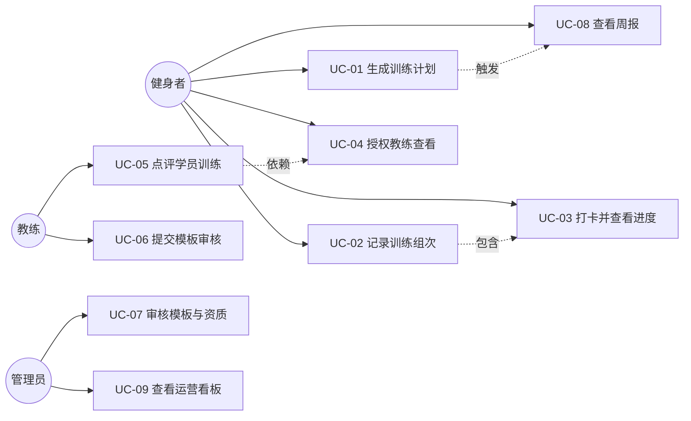

**用例清单**

| 用例 | 名称 | 主参与者 | 优先级 | 关联 FR |
|------|------|---------|-------|---------|
| UC-01 | 生成训练计划 | 健身者 | 高 | FR-03, FR-09, FR-10 |
| UC-02 | 记录训练组次 | 健身者 | 高 | FR-13, FR-14 |
| UC-03 | 打卡并查看进度 | 健身者 | 高 | FR-15, FR-12 |
| UC-04 | 授权教练查看 | 健身者 | 高 | FR-04, FR-18 |
| UC-05 | 点评学员训练 | 教练 | 高 | FR-19 |
| UC-06 | 提交模板审核 | 教练 | 中 | FR-07, FR-08 |
| UC-07 | 审核模板与资质 | 管理员 | 高 | FR-08, FR-17, FR-28 |
| UC-08 | 查看周报 | 健身者 | 中 | FR-24, FR-26 |
| UC-09 | 查看运营看板 | 管理员 | 中 | FR-28 |

---

#### UC-01 生成训练计划

| 项 | 内容 |
|----|------|
| 主参与者 | 健身者 |
| 前置条件 | 已登录；已完成身体档案（目标、训练年限、每周可练天数、可用器械） |
| 触发 | 用户点击"生成计划" |
| **主流程** | 1. 系统校验档案完整性，缺失项提示补充<br>2. 用户确认目标（增肌/减脂/塑形/力量）与周期（默认 4 周）<br>3. 计划服务按规则选择模板骨架（按每周天数与分化方式）<br>4. 动作库按器械条件过滤候选动作，按肌群配额填充训练日<br>5. 校验动作无冲突（同一训练日不重复同一动作）<br>6. 生成计划实例与训练日清单，状态置为"草稿"<br>7. 返回计划预览，用户可微调动作后激活 |
| **异常流程** | E1：档案缺失 → 提示补全，不生成<br>E2：器械条件下可用动作不足（如无器械且目标为力量）→ 降级为徒手方案并标注原因<br>E3：生成超时（>3s）→ 转异步，先返回"生成中"，完成后通知 |
| 后置条件 | 生成 4 周计划实例（草稿态），并写入操作日志 |
| 业务规则 | 单次训练日动作数 4–6 个；同一肌群每周训练频次不超过 3 次 |

#### UC-02 记录训练组次

| 项 | 内容 |
|----|------|
| 主参与者 | 健身者 |
| 前置条件 | 已登录；存在进行中的训练日（计划状态为"进行中"） |
| 触发 | 用户在今日训练页开始记录 |
| **主流程** | 1. 系统加载该训练日的动作清单与上次同动作数据（用于重量参考）<br>2. 用户逐组录入重量、次数、RPE<br>3. 每次录入即时本地暂存，网络恢复后提交<br>4. 服务端校验数值范围 → 写入组记录 → 计算本次容量增量<br>5. 发送 `stat.daily.aggregate` 消息（异步聚合）<br>6. 返回本次已记录组数与累计容量 |
| **异常流程** | E1：重量/次数越界（负数或超阈值）→ 拒绝并提示<br>E2：重复提交（同一组二次提交）→ 按幂等键去重，返回上次结果<br>E3：消息发送失败 → 记录本地补偿表，定时任务重发 |
| 后置条件 | 组记录落库；聚合在 5s 内可见（对应 NFR-02） |
| 业务规则 | 允许跳过动作；RPE 取值 1–10，可为空 |

#### UC-05 点评学员训练

| 项 | 内容 |
|----|------|
| 主参与者 | 教练 |
| 前置条件 | 教练账号已通过资质审核；学员已在授权有效期内授权该教练 |
| 触发 | 教练在学员列表点击"点评" |
| **主流程** | 1. 系统校验角色为教练、且存在有效期内的授权记录<br>2. 展示该学员授权范围内的训练摘要（容量趋势、完成率、缺练部位）<br>3. 教练填写点评内容与调整建议（可关联到计划的某个训练日）<br>4. 服务端保存点评，发送 `notify.audit.result` 类通知给学员<br>5. 若涉及计划调整，生成"计划调整建议"待学员确认 |
| **异常流程** | E1：无授权或授权已过期 → 403，且不泄露学员任何数据<br>E2：学员已收回授权 → 同上<br>E3：点评内容触发敏感词 → 进入待审核队列 |
| 后置条件 | 点评落库；学员收到通知；操作写入审计日志 |
| 业务规则 | **教练只能读取授权范围内的数据**；越权查询必须返回空结果而非报错详情（避免探测） |

#### UC-07 审核模板与资质

| 项 | 内容 |
|----|------|
| 主参与者 | 管理员 |
| 前置条件 | 存在"待审核"状态的模板或教练资质申请 |
| 触发 | 管理员打开审核队列 |
| **主流程** | 1. 系统列出待审核项，按提交时间排序<br>2. 管理员查看内容与作者信息（作者敏感字段脱敏）<br>3. 选择"通过"或"驳回"并填写意见<br>4. 状态按审核流迁移（待审核 → 已通过 / 已驳回）<br>5. 通过后触发上架；驳回则通知作者修改后重提<br>6. 写入审核记录（审核人、意见、时间） |
| **异常流程** | E1：并发审核（两人同时处理）→ 乐观锁版本冲突，后提交者提示"已被处理"<br>E2：通过的模板含违规内容（事后举报）→ 下架并记录 |
| 后置条件 | 状态迁移完成，审核记录可追溯 |
| 业务规则 | 管理员**不可查看**用户训练明细与身体档案；审核操作必须留痕 |

#### UC-08 查看周报

| 项 | 内容 |
|----|------|
| 主参与者 | 健身者 |
| 前置条件 | 该用户已产生至少 1 周训练数据 |
| 触发 | 用户打开"周报"页，或收到周报推送 |
| **主流程** | 1. 系统查询该周聚合数据（优先缓存）<br>2. 组装周报：总容量、训练次数、达成率、肌群分布、异常提示（如连续缺练）<br>3. 若无缓存则读 `t_daily_stat` 汇总并回填缓存<br>4. 返回结构化周报并渲染图表 |
| **异常流程** | E1：该周无数据 → 返回"本周未训练"引导页<br>E2：聚合表缺失（异步任务失败）→ 实时兜底计算并标记"估算值" |
| 后置条件 | 无（只读） |
| 业务规则 | 周报口径以"周一 00:00 至周日 23:59"为准，时区固定 Asia/Shanghai |

---

## 2 架构总览

### 2.1 架构目标与策略

| 最高优先级质量属性 | 采用的架构策略 | 体现在哪些视图 |
|------------------|--------------|--------------|
| 安全性（数据可见性） | ① 认证与鉴权分离：JWT 只携带身份，权限在服务端按「角色 × 资源归属 × 授权关系」判定<br>② 数据访问层统一注入授权过滤条件，避免各接口自行拼 SQL<br>③ 管理员视角做聚合与脱敏，物理上不返回明细字段 | 逻辑（§3.3 拦截位置）、数据（§4.8 字段脱敏）、运行（§6.10 认证机制）、开发（§5.7 规范） |
| 可维护性（单人 14 周可迭代） | ① 四层架构 + 依赖检查脚本，把架构约束变成可执行的 CI 卡点<br>② 计划生成用策略 + 规则表，新增目标类型不改主干代码<br>③ 统计口径集中在一处（聚合服务），避免散落 | 逻辑（§3.3 R-01~R-04）、开发（§5.7、Skill）、数据（§4.7 缓存边界） |
| 性能（够用即可） | ① 统计走预聚合表 + 缓存，避免实时扫日志<br>② 打卡写入与聚合解耦（消息），写入路径只做单表插入<br>③ 列表接口强制分页 | 运行（§6.5、§6.6）、数据（§4.7）、物理（§7.7 扩容策略） |

### 2.2 架构风格选择

**选定风格**：**单体分层架构（四层）+ 局部事件驱动**（统计聚合与通知走消息），统计侧局部借鉴 CQRS 的读写分离思路。

| 候选风格 | 优点（针对本项目） | 缺点 | 是否采用 |
|---------|-----------------|------|---------|
| 单体分层 | 单人可控、部署简单、事务边界清晰；四层能明确约束依赖方向 | 扩展性受单机限制（本项目 DAU 2000 无压力） | **✅ 主干** |
| 微服务 | 模块解耦、可独立扩容 | 单人 14 周要维护注册中心、网关、分布式事务，运维成本远超收益；且本系统事务边界集中在"打卡→聚合" | ❌ |
| 纯事件驱动 | 异步解耦彻底 | 调试与一致性推理成本高；核心写入链路（记组次）需要强一致 | ⚠️ 局部采用 |
| 管道-过滤器 | 适合数据加工流水线 | 不适合以 CRUD + 规则计算为主的业务形态 | ❌ |

**取舍说明**：为什么不用更复杂的 —— 微服务的分布式事务、服务发现、链路治理在 DAU 2000 的规模上没有收益，反而会挤占架构文档与实现的时间；为什么不用更简单的 —— 纯三层（Controller-Service-DAO）会让"计划生成规则"和"统计聚合"这类领域逻辑无处安放，最终堆进 Service 变成上帝类，因此保留独立的 `domain` 层。

> 必须同时回答"为什么不用更简单的"和"为什么不用更复杂的"。选微服务必须论证规模真的需要。

### 2.3 系统上下文图

**图 2-1 系统上下文**

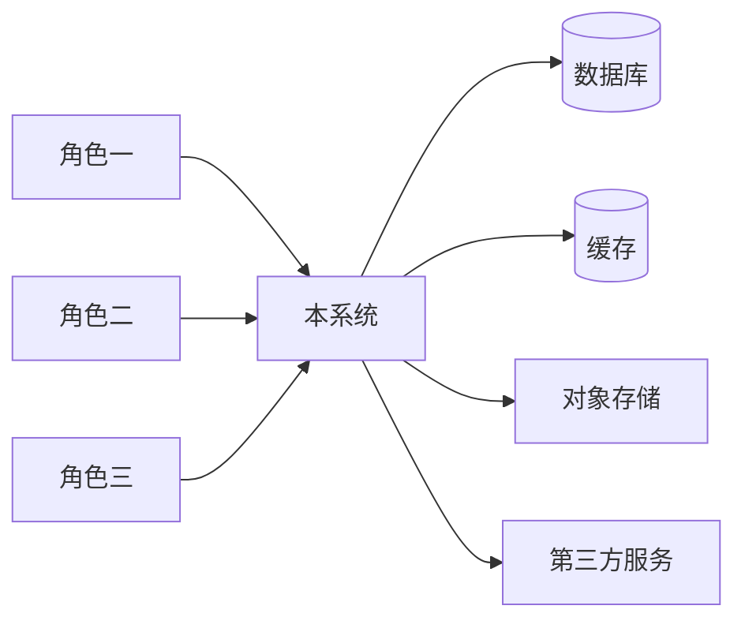

**外部系统清单**

| 外部系统 | 交互方式 | 数据流向 | 失败时的降级策略 |
|---------|---------|---------|----------------|
| | | | |

### 2.4 架构决策记录（ADR）汇总

| ADR 编号 | 决策主题 | 状态 | 涉及视图 |
|---------|---------|------|---------|
| [ADR-001](adr/ADR-001-后端框架选型.md) | 后端框架选型 | 已接受 | 开发 / 运行 |
| [ADR-002](adr/ADR-002-前端框架选型.md) | 前端框架选型 | 已接受 | 开发 |
| [ADR-003](adr/ADR-003-数据存储选型.md) | 数据存储选型 | 已接受 | 数据 |
| [ADR-004](adr/ADR-004-缓存策略.md) | 缓存策略 | 已接受 | 数据 / 运行 |
| [ADR-005](adr/ADR-005-认证授权方案.md) | 认证授权方案 | 提案 | 逻辑 / 运行 |
| [ADR-006](adr/ADR-006-部署形态.md) | 部署形态 | 提案 | 物理 |
| [ADR-007](adr/ADR-007-异步与消息机制.md) | 异步与消息机制 | 提案 | 运行 |
| [ADR-008](adr/ADR-008-模块划分方式.md) | 模块划分方式 | 提案 | 逻辑 / 开发 |

> 硬性要求：≥8 条，明细见 `adr/` 目录。当前已完成 4 条（检查点 2 达标），剩余 4 条第 9 周前补齐。

---

## 3 逻辑架构视图（Logical View）

> 关注点：为终端用户提供什么功能？如何划分为职责内聚的单元？单元之间如何协作？

### 3.1 功能结构图

**图 3-1 功能结构（与 §1.3 模块树一致，标注重点实现模块）**

```mermaid
graph TD
  A[FitMate] --> B[账号与身体档案]
  A --> C[动作库与训练模板]
  A --> D[训练计划 ★]
  A --> E[训练执行与打卡 ★]
  A --> F[教练服务]
  A --> G[数据统计 ★]
  A --> H[通知与运营]

  B --> B1[注册登录]
  B --> B2[身体档案]
  B --> B3[目标与器械]
  B --> B4[隐私授权]

  C --> C1[动作分类]
  C --> C2[动作素材]
  C --> C3[模板与版本]
  C --> C4[模板审核]

  D --> D1[计划生成]
  D --> D2[周期化推进]
  D --> D3[计划调整]
  D --> D4[完成度]

  E --> E1[今日清单]
  E --> E2[组次记录]
  E --> E3[打卡]
  E --> E4[笔记照片]

  F --> F1[教练审核]
  F --> F2[学员授权]
  F --> F3[点评建议]
  F --> F4[带训申请]

  G --> G1[容量曲线]
  G --> G2[肌群平衡]
  G --> G3[达成率]
  G --> G4[周报月报]

  H --> H1[训练提醒]
  H --> H2[消息中心]
  H --> H3[成就徽章]
  H --> H4[后台看板]
```

> ★ 标记为本期重点实现模块，对应答辩演示重点。

### 3.2 容器 / 子系统划分（C4-Container）

**图 3-2 容器视图**

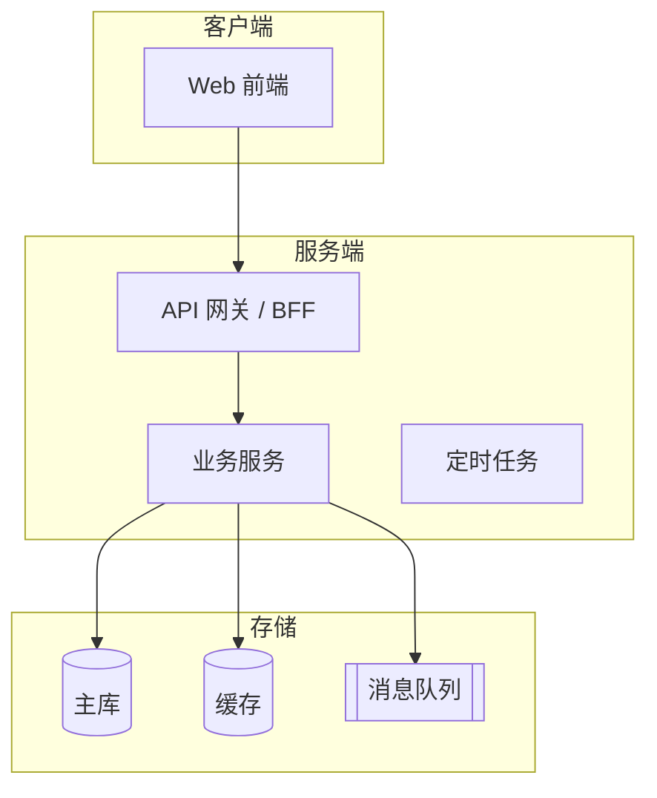

| 容器 | 职责 | 技术选型 | 通信协议 |
|------|------|---------|---------|
| Web 前端 | 页面渲染、表单校验、图表展示 | Vue 3 + Vite + Pinia + ECharts | HTTPS / JSON |
| API 应用（单体） | 业务接口、鉴权、领域逻辑编排 | Spring Boot 3（内嵌 Tomcat） | HTTPS / JSON |
| 定时任务 | 训练提醒、周报触发、日聚合补偿 | Spring Scheduler（单实例，带分布式锁保护） | 进程内调用 |
| 消息消费者 | 统计聚合、通知投递 | Spring AMQP（RabbitMQ 客户端） | AMQP |
| 关系库 | 业务数据、聚合数据、审核记录 | MySQL 8.0（InnoDB，utf8mb4） | JDBC / HikariCP |
| 缓存 | 统计结果、热点动作库、会话黑名单 | Redis 7 | RESP |
| 消息队列 | 异步解耦与削峰 | RabbitMQ 3.x | AMQP 0-9-1 |
| 对象存储（可选） | 训练照片、动作示范素材 | MinIO（本地部署）或服务器磁盘 | HTTP |

> 说明：本期为**单体应用 + 独立中间件**，不拆微服务（见 §2.2 论证）。上表的"容器"是 C4 意义上的可部署单元，不是 Docker 容器概念。

### 3.3 分层架构与依赖规则

**图 3-3 分层与依赖方向**

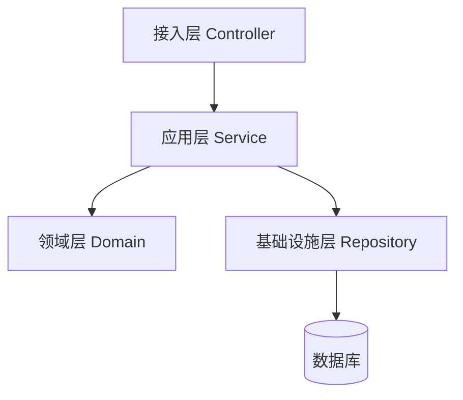

**依赖规则（这些规则将原样写进 Skill，是逻辑视图与 Skill 的一致性锚点）**

| 规则 ID | 内容 | 检查方式 |
|---------|------|---------|
| R-01 | 禁止 Controller 直接调用 Repository | `check-layering.py` / Review |
| R-02 | 禁止领域层依赖 Web 框架注解 | `check-layering.py` |
| R-03 | 禁止同层之间横向调用 | Review |
| R-04 | 禁止基础设施层反向依赖应用层 | `check-layering.py` |

### 3.4 领域模型 / 核心类图（≥8 个实体）

**图 3-4 核心领域模型（节选 12 个实体，完整字段见 §4.2 数据字典）**

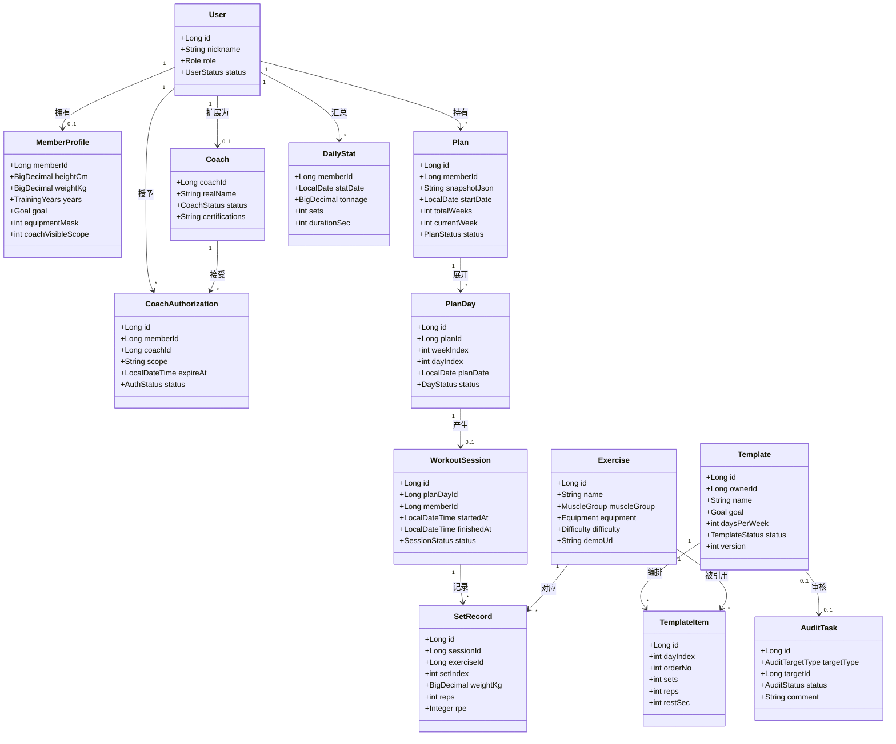

| 实体 | 含义 | 关键属性 | 与其他实体的关系 |
|------|------|---------|----------------|
| User | 账号主体（统一身份） | role、status、nickname | 1:1 扩展 MemberProfile / Coach；1:N 授权、计划、统计 |
| MemberProfile | 健身者身体与偏好档案 | 身高体重体脂、训练年限、目标、器械位掩码、教练可见范围 | 1:1 User |
| Coach | 教练资质与状态 | 真实姓名、认证信息、审核状态 | 1:1 User；1:N 授权 |
| CoachAuthorization | 学员对教练的**授权关系**（核心领域对象） | scope、expireAt、status | N:1 Member / Coach |
| Exercise | 动作库条目 | 肌群、器械、难度、示范素材 | 1:N TemplateItem、SetRecord |
| Template | 可复用的模板（教练/用户创建） | goal、daysPerWeek、version、status | 1:N TemplateItem；1:1 AuditTask |
| TemplateItem | 模板中的一条动作安排 | dayIndex、sets、reps、restSec | N:1 Template / Exercise |
| Plan | 用户持有的计划**实例**（含模板快照） | snapshotJson、startDate、totalWeeks、currentWeek、status | N:1 User；1:N PlanDay |
| PlanDay | 计划中的某一个训练日 | weekIndex、dayIndex、planDate、status | N:1 Plan；1:0..1 WorkoutSession |
| WorkoutSession | 一次实际训练（会话） | startedAt、finishedAt、status | N:1 PlanDay；1:N SetRecord |
| SetRecord | 单组记录（最细粒度事实） | setIndex、weightKg、reps、rpe | N:1 WorkoutSession / Exercise |
| DailyStat | 按天预聚合的统计结果 | statDate、tonnage、sets、durationSec | N:1 User |
| AuditTask | 审核工单（模板/资质共用） | targetType、targetId、status、comment | 1:1 Template 或 Coach |

> 关键关系说明：**Plan 与 Template 不是外键绑定，而是快照**（`snapshotJson`）。这是 §6.4 提到的"运行视图约束反向修改数据视图"的具体体现 —— 模板下架后历史计划仍可完整回放。

### 3.5 关键接口定义（≥5 个）

| 接口 ID | 接口名 | 签名 | 前置条件 | 后置条件 | 异常约定 |
|---------|-------|------|---------|---------|---------|
| IF-01 | 生成计划 | `POST /api/v1/plans:generate`<br>`PlanGenerateReq{goal, daysPerWeek, equipment[], weeks}` → `PlanVO{planId, days[]}` | 已认证；档案完整（FR-02/03） | 生成 Plan（草稿）+ PlanDay 清单；写操作日志 | 400 档案缺失（字段级提示）；409 存在进行中计划；503 规则计算超时（转异步任务） |
| IF-02 | 记录组次 | `POST /api/v1/sessions/{sid}/sets`<br>`SetReq{exerciseId, setIndex, weightKg, reps, rpe, clientToken}` → `SetVO{id, sessionTonnage}` | 会话属于当前用户且状态为进行中 | 写入 SetRecord；发送聚合消息；返回累计容量 | 400 数值越界；403 非本人会话；409 幂等冲突（返回首次结果，不报错） |
| IF-03 | 容量趋势 | `GET /api/v1/stats/tonnage?from&to&granularity=day\|week` → `TonnageVO{points[], total}` | 已认证；只能查本人或已授权学员 | 命中缓存或读 DailyStat | 403 未授权；422 时间跨度 > 365 天 |
| IF-04 | 学员授权 | `POST /api/v1/coach/authorizations`<br>`AuthReq{coachId, scope, expireAt}` → `AuthVO{id, status}` | 当前用户为 Member；教练已通过资质审核 | 创建/续期授权关系；通知教练 | 400 expireAt 早于当前；404 教练不存在或未生效；409 已存在有效授权（返回原记录） |
| IF-05 | 审核决定 | `POST /api/v1/audits/{id}/decision`<br>`DecisionReq{pass, comment, version}` → `AuditVO{status}` | 当前用户为 Admin；任务状态为待审核 | 状态迁移；写审核记录；通知作者 | 403 非管理员；409 版本冲突（已被他人处理）；422 驳回未填意见 |
| IF-06 | 查看周报 | `GET /api/v1/reports/weekly/{weekStart}` → `WeeklyReportVO{tonnage, sessions, completionRate, muscleSplit[], hints[]}` | 已认证；weekStart 为周一 | 返回周报（缓存优先） | 404 该周无数据（返回空结构 + 引导）；403 查他人且未授权 |

> 接口设计约定：所有响应统一 `Result<T>{code, message, data}`；分页统一 `PageResult<T>`；错误码采用「HTTP 状态 + 业务码」双轨（如 `403 + AUTH_1003`）。

### 3.6 关键场景时序图（≥3 个）

> 必须覆盖：一个跨模块、一个含外部系统调用、一个失败/异常流程。

**图 3-5 场景 1：跨模块 —— 生成 4 周训练计划（UC-01）**

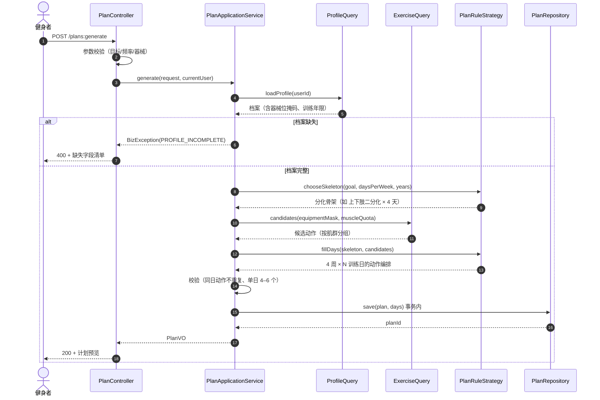

**关键分支解读**：档案校验前置（避免生成到一半失败）；规则计算在领域层 `PlanRuleStrategy` 内完成，应用层只负责编排与事务边界；动作候选查询被抽象为 `ExerciseQuery` 接口（domain 定义、infrastructure 实现），因此计划模块不直接依赖动作库的表。

**图 3-6 场景 2：含外部系统调用 —— 打卡异步聚合（UC-02，对应 C3）**

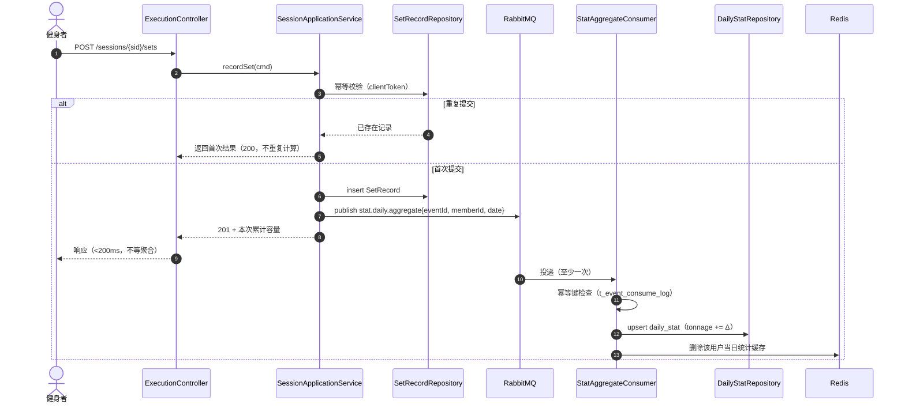

**关键分支解读**：写入路径不等待聚合（对应 NFR-02 的 5s 目标）；消息"至少一次"投递由消费端幂等表兜底；缓存采用"先写库再删缓存"（Cache-Aside 的失效模式），避免脏读。

**图 3-7 场景 3：异常 / 失败流程 —— 教练越权访问与并发审核冲突**

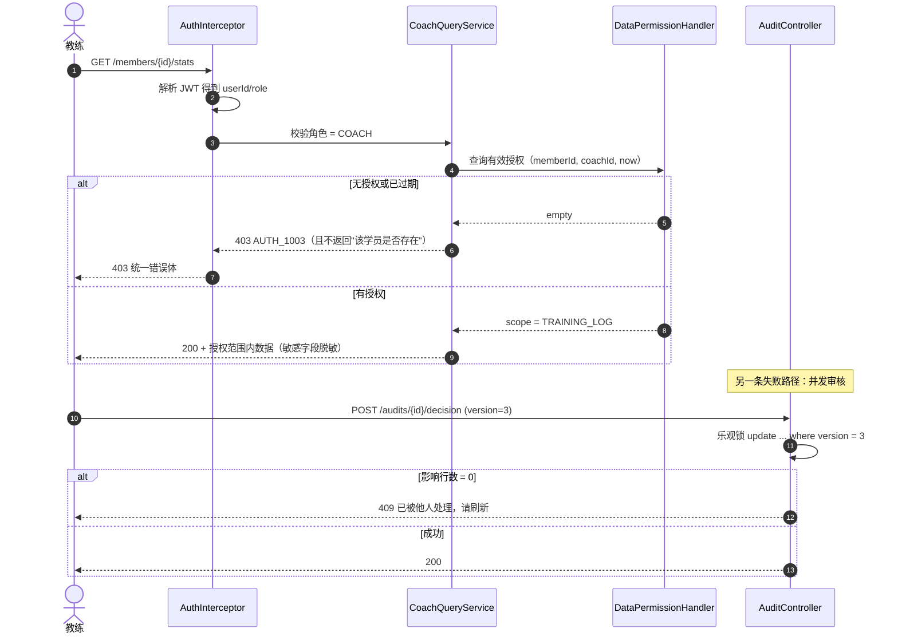

**关键分支解读**：越权返回 **403 而非 404**，且响应体不区分"学员不存在"与"无权限"，避免通过错误差异探测他人 ID；审核用乐观锁解决并发（UC-07 异常 E1），冲突时提示刷新而不是静默覆盖。

### 3.7 模块职责与依赖矩阵

| 模块 | 职责 | 依赖的模块 | 被谁依赖 | 对外接口数 |
|------|------|-----------|---------|-----------|
| 账号与身体档案 account | 身份、档案、授权范围 | —（基础模块） | 全部模块 | 8 |
| 动作库与模板 exercise | 动作资产、模板编排、模板状态 | account（作者归属） | 训练计划、统计 | 7 |
| 训练计划 plan | 计划生成、周期推进、调整 | exercise（取动作）、account（取档案） | 训练执行、统计 | 6 |
| 训练执行与打卡 execution | 会话、组次记录、打卡 | plan（取训练日）、exercise（校验动作） | 统计、通知 | 9 |
| 教练服务 coach | 资质、授权关系、点评 | account（身份）、plan（读计划结构） | 通知 | 6 |
| 数据统计 stats | 聚合、趋势、周报 | execution（读事实）、plan（读计划口径） | 教练服务、通知 | 5 |
| 通知与运营 notify | 提醒、消息中心、审核队列 | 全部（作为事件消费者） | —（终端消费） | 5 |

**循环依赖检查结论**：**通过（无环）**。

依赖拓扑为单向分层：`account → exercise → plan → execution → stats → notify`，其中 `coach` 依赖 `account` 与 `plan` 但**不被 plan 依赖**（点评通过事件回传，不回写计划主干）；`notify` 只消费事件、不被任何模块依赖。因此不存在 A→B→C→A 的环。检查方式：模块间仅允许通过 `application` 层暴露的 Facade 接口调用，跨模块禁止直接访问对方 Repository（可加入 `check-layering.py` 的模块级规则）。

### 3.8 本节自检

- [ ] 一级模块 ≥6 个，职责内聚、边界清晰
- [ ] 无反向依赖、无跨层调用
- [ ] 类图实体与第 4 章 ER 图一致
- [ ] 时序图覆盖跨模块 / 外部系统 / 异常流程
- [ ] 依赖矩阵无环

---

## 4 数据架构视图（Data View）

> 关注点：数据如何组织、存储、流转、一致化与保护？

### 4.1 ER 图（≥10 个实体）

**图 4-1 ER 图（14 个实体）**

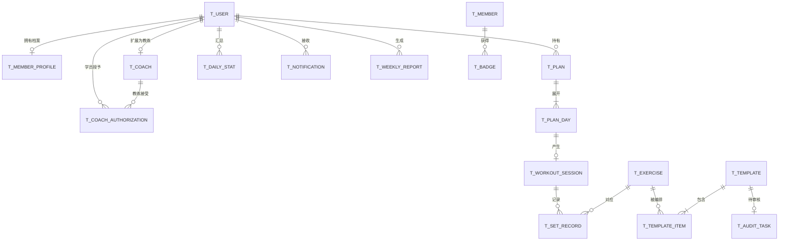

> 说明：图中未展开 `T_MEMBER`（健身者视图，实际由 `T_USER` + `T_MEMBER_PROFILE` 组合表示）；`T_BADGE` 为基础表，字段从简。ER 图与 §4.2 数据字典、以及最终建表脚本（`V1__init.sql`）必须**完全一致** —— 这是任务书明列的 −4 分项。

### 4.2 数据字典（核心表 12 张 + 补充表 5 张）

**全局建表约定**（所有表适用，下表不再重复说明）

- 主键：`id BIGINT UNSIGNED AUTO_INCREMENT`；字符集 `utf8mb4` / 排序 `utf8mb4_0900_ai_ci`
- 审计字段：`created_at DATETIME NOT NULL DEFAULT CURRENT_TIMESTAMP`、`updated_at DATETIME NOT NULL DEFAULT CURRENT_TIMESTAMP ON UPDATE CURRENT_TIMESTAMP`
- 逻辑删除：`deleted TINYINT NOT NULL DEFAULT 0`（查询统一附加 `deleted = 0`）
- 时间统一 `DATETIME`（Asia/Shanghai），金额/重量用 `DECIMAL`，**禁止 `FLOAT/DOUBLE`**
- 所有外键列建索引；高频查询列额外建组合索引（见 §4.4）

**表 4-1 t_user（用户）**

| 字段 | 类型 | 长度 | 约束 | 默认值 | 业务含义 |
|------|------|------|------|-------|---------|
| id | BIGINT | — | PK, 自增 | — | 主键 |
| nickname | VARCHAR | 32 | NOT NULL | — | 昵称，展示用 |
| phone | VARCHAR | 20 | UNIQUE, NOT NULL | — | 登录手机号（加密存储，唯一） |
| password_hash | VARCHAR | 100 | NOT NULL | — | BCrypt 加盐哈希，禁止明文 |
| role | VARCHAR | 16 | NOT NULL, 枚举 MEMBER/COACH/ADMIN | MEMBER | 角色，决定权限基线 |
| status | TINYINT | — | NOT NULL | 1 | 1 正常 / 0 禁用 / 2 注销待清理 |
| last_login_at | DATETIME | — | NULL | NULL | 最后登录时间，用于活跃统计 |
| created_at / updated_at / deleted | — | — | 见全局约定 | — | 审计字段 |

**表 4-2 t_member_profile（健身者档案）**

| 字段 | 类型 | 长度 | 约束 | 默认值 | 业务含义 |
|------|------|------|------|-------|---------|
| member_id | BIGINT | — | PK, FK→t_user.id | — | 与用户一对一 |
| height_cm | DECIMAL | (5,1) | NULL | NULL | 身高，用于计算相对力量 |
| weight_kg | DECIMAL | (5,1) | NULL | NULL | 体重，趋势分析用 |
| body_fat_pct | DECIMAL | (4,1) | NULL | NULL | 体脂率，可为空（非必填） |
| training_years | DECIMAL | (3,1) | NOT NULL | 0 | 训练年限，决定计划强度档位 |
| goal | VARCHAR | 16 | NOT NULL, 枚举 HYPERTROPHY/FAT_LOSS/TONE/STRENGTH | — | 训练目标，计划生成的输入 |
| equipment_mask | INT | — | NOT NULL | 0 | 器械条件位掩码（1 杠铃/2 哑铃/4 器械/8 弹力带/16 徒手） |
| coach_visible_scope | VARCHAR | 64 | NOT NULL | NONE | 授权可见范围：NONE/SUMMARY/DETAIL |
| created_at / updated_at / deleted | — | — | 见全局约定 | — | 审计字段 |

**表 4-3 t_coach（教练）**

| 字段 | 类型 | 长度 | 约束 | 默认值 | 业务含义 |
|------|------|------|------|-------|---------|
| coach_id | BIGINT | — | PK, FK→t_user.id | — | 与用户一对一 |
| real_name | VARCHAR | 32 | NOT NULL | — | 真实姓名（仅管理员与已授权学员可见） |
| certifications | VARCHAR | 255 | NULL | NULL | 资质证明（文本或文件 URL） |
| years | TINYINT | — | NOT NULL | 0 | 从业年限，展示用 |
| intro | VARCHAR | 500 | NULL | NULL | 简介 |
| status | VARCHAR | 16 | NOT NULL, 枚举 PENDING/ACTIVE/REJECTED/SUSPENDED | PENDING | 资质审核状态（对应审核流） |
| audit_task_id | BIGINT | — | NULL, FK→t_audit_task.id | NULL | 关联的审核工单 |
| created_at / updated_at / deleted | — | — | 见全局约定 | — | 审计字段 |

**表 4-4 t_coach_authorization（学员-教练授权关系，核心领域对象）**

| 字段 | 类型 | 长度 | 约束 | 默认值 | 业务含义 |
|------|------|------|------|-------|---------|
| id | BIGINT | — | PK, 自增 | — | 主键 |
| member_id | BIGINT | — | NOT NULL, FK→t_user.id | — | 授权方（学员） |
| coach_id | BIGINT | — | NOT NULL, FK→t_user.id | — | 被授权方（教练） |
| scope | VARCHAR | 64 | NOT NULL | SUMMARY | 可见范围：SUMMARY（汇总）/DETAIL（含组次） |
| expire_at | DATETIME | — | NOT NULL | — | 授权到期时间，过期即失效 |
| status | VARCHAR | 16 | NOT NULL, 枚举 ACTIVE/REVOKED/EXPIRED | ACTIVE | 状态，学员可随时收回 |
| revoked_at | DATETIME | — | NULL | NULL | 收回时间，用于审计 |
| created_at / updated_at | — | — | 见全局约定 | — | 审计字段 |
| — | — | — | UNIQUE(member_id, coach_id, status) | — | 防止重复有效授权 |

**表 4-5 t_exercise（动作库）**

| 字段 | 类型 | 长度 | 约束 | 默认值 | 业务含义 |
|------|------|------|------|-------|---------|
| id | BIGINT | — | PK, 自增 | — | 主键 |
| name | VARCHAR | 64 | NOT NULL, UNIQUE | — | 动作名（如"杠铃卧推"） |
| muscle_group | VARCHAR | 32 | NOT NULL | — | 主肌群：CHEST/BACK/LEGS/SHOULDER/ARMS/CORE |
| equipment | VARCHAR | 32 | NOT NULL | — | 所需器械，与档案的位掩码映射 |
| difficulty | TINYINT | — | NOT NULL | 2 | 难度 1–4，用于新手过滤 |
| demo_url | VARCHAR | 255 | NULL | NULL | 示范素材地址（对象存储） |
| tips | VARCHAR | 500 | NULL | NULL | 动作要领文本 |
| status | TINYINT | — | NOT NULL | 1 | 1 启用 / 0 停用 |
| created_at / updated_at / deleted | — | — | 见全局约定 | — | 审计字段 |

**表 4-6 t_template（训练模板）**

| 字段 | 类型 | 长度 | 约束 | 默认值 | 业务含义 |
|------|------|------|------|-------|---------|
| id | BIGINT | — | PK, 自增 | — | 主键 |
| owner_id | BIGINT | — | NOT NULL, FK→t_user.id | — | 创建者（教练或用户） |
| name | VARCHAR | 64 | NOT NULL | — | 模板名 |
| goal | VARCHAR | 16 | NOT NULL | — | 适配目标 |
| days_per_week | TINYINT | — | NOT NULL | 3 | 每周训练天数 |
| status | VARCHAR | 16 | NOT NULL, 枚举 DRAFT/PENDING/APPROVED/REJECTED/PUBLISHED/OFFLINE | DRAFT | 审核流状态（见 §6.4） |
| version | INT | — | NOT NULL | 1 | 版本号，驳回重提时 +1 |
| audit_task_id | BIGINT | — | NULL, FK→t_audit_task.id | NULL | 当前审核工单 |
| published_at | DATETIME | — | NULL | NULL | 上架时间，用于"最新模板"排序 |
| created_at / updated_at / deleted | — | — | 见全局约定 | — | 审计字段 |

**表 4-7 t_plan（计划实例）**

| 字段 | 类型 | 长度 | 约束 | 默认值 | 业务含义 |
|------|------|------|------|-------|---------|
| id | BIGINT | — | PK, 自增 | — | 主键 |
| member_id | BIGINT | — | NOT NULL, FK→t_user.id | — | 持有者 |
| source_template_id | BIGINT | — | NULL, FK→t_template.id | NULL | 来源模板（仅溯源，**不用于渲染**） |
| snapshot_json | JSON | — | NOT NULL | — | 生成时的计划结构快照（模板下架不影响历史计划） |
| goal | VARCHAR | 16 | NOT NULL | — | 生成时的目标，便于统计分组 |
| start_date | DATE | — | NOT NULL | — | 周期起始日 |
| total_weeks | TINYINT | — | NOT NULL | 4 | 周期长度 |
| current_week | TINYINT | — | NOT NULL | 1 | 当前周次，定时任务推进 |
| status | VARCHAR | 16 | NOT NULL, 枚举 DRAFT/ACTIVE/COMPLETED/ABORTED | DRAFT | 计划生命周期（见 §6.4） |
| created_at / updated_at / deleted | — | — | 见全局约定 | — | 审计字段 |
| — | — | — | UNIQUE(member_id, status) 部分索引：仅 ACTIVE | — | 保证同一用户只有一个进行中计划（MySQL 8 用函数索引或应用层约束） |

**表 4-8 t_plan_day（计划训练日）**

| 字段 | 类型 | 长度 | 约束 | 默认值 | 业务含义 |
|------|------|------|------|-------|---------|
| id | BIGINT | — | PK, 自增 | — | 主键 |
| plan_id | BIGINT | — | NOT NULL, FK→t_plan.id | — | 所属计划 |
| week_index | TINYINT | — | NOT NULL | — | 第几周（1–4） |
| day_index | TINYINT | — | NOT NULL | — | 本周第几练（1–5） |
| plan_date | DATE | — | NULL | NULL | 计划日期，激活时按开始日推算 |
| focus | VARCHAR | 64 | NULL | NULL | 训练重点（如"上肢推"） |
| status | VARCHAR | 16 | NOT NULL, 枚举 PENDING/DONE/SKIPPED | PENDING | 训练日状态 |
| created_at / updated_at | — | — | 见全局约定 | — | 审计字段 |
| — | — | — | UNIQUE(plan_id, week_index, day_index) | — | 防止同一计划重复生成训练日 |

**表 4-9 t_workout_session（训练会话）**

| 字段 | 类型 | 长度 | 约束 | 默认值 | 业务含义 |
|------|------|------|------|-------|---------|
| id | BIGINT | — | PK, 自增 | — | 主键 |
| plan_day_id | BIGINT | — | NULL, FK→t_plan_day.id | NULL | 关联训练日（自由训练可为空） |
| member_id | BIGINT | — | NOT NULL, FK→t_user.id | — | 训练者 |
| started_at | DATETIME | — | NOT NULL | — | 开始时间 |
| finished_at | DATETIME | — | NULL | NULL | 结束时间，未结束为 NULL |
| duration_sec | INT | — | NULL | NULL | 时长（秒），结束时回填 |
| status | VARCHAR | 16 | NOT NULL, 枚举 ONGOING/FINISHED/ABANDONED | ONGOING | 会话状态 |
| created_at / updated_at | — | — | 见全局约定 | — | 审计字段 |

**表 4-10 t_set_record（组次记录，最细粒度事实表）**

| 字段 | 类型 | 长度 | 约束 | 默认值 | 业务含义 |
|------|------|------|------|-------|---------|
| id | BIGINT | — | PK, 自增 | — | 主键 |
| session_id | BIGINT | — | NOT NULL, FK→t_workout_session.id | — | 所属会话 |
| exercise_id | BIGINT | — | NOT NULL, FK→t_exercise.id | — | 动作 |
| set_index | TINYINT | — | NOT NULL | — | 第几组（从 1 开始） |
| weight_kg | DECIMAL | (6,2) | NOT NULL | 0 | 重量（自重动作记 0） |
| reps | SMALLINT | — | NOT NULL | — | 次数 |
| rpe | TINYINT | — | NULL, CHECK 1–10 | NULL | 主观强度，可空 |
| client_token | VARCHAR | 64 | UNIQUE, NOT NULL | — | 客户端幂等键（防重复提交） |
| created_at | DATETIME | — | 见全局约定 | — | 记录时间 |

**表 4-11 t_daily_stat（日聚合表）**

| 字段 | 类型 | 长度 | 约束 | 默认值 | 业务含义 |
|------|------|------|------|-------|---------|
| member_id | BIGINT | — | PK 之一, FK→t_user.id | — | 用户 |
| stat_date | DATE | — | PK 之一 | — | 统计日 |
| tonnage | DECIMAL | (12,2) | NOT NULL | 0 | 当日容量（Σ 重量×次数） |
| sets | INT | — | NOT NULL | 0 | 当日总组数 |
| sessions | INT | — | NOT NULL | 0 | 当日训练会话数 |
| duration_sec | INT | — | NOT NULL | 0 | 当日总时长 |
| updated_at | DATETIME | — | 见全局约定 | — | 最后聚合时间 |
| — | — | — | PRIMARY KEY(member_id, stat_date) | — | 组合主键，天然幂等（upsert） |

**表 4-12 t_audit_task（审核工单）**

| 字段 | 类型 | 长度 | 约束 | 默认值 | 业务含义 |
|------|------|------|------|-------|---------|
| id | BIGINT | — | PK, 自增 | — | 主键 |
| target_type | VARCHAR | 16 | NOT NULL, 枚举 TEMPLATE/COACH | — | 审核对象类型（复用同一工单表） |
| target_id | BIGINT | — | NOT NULL | — | 对象 ID |
| status | VARCHAR | 16 | NOT NULL, 枚举 PENDING/APPROVED/REJECTED | PENDING | 工单状态 |
| reviewer_id | BIGINT | — | NULL, FK→t_user.id | NULL | 审核人（管理员） |
| comment | VARCHAR | 500 | NULL | NULL | 审核意见（驳回必填） |
| submitted_at | DATETIME | — | NOT NULL | — | 提交时间 |
| decided_at | DATETIME | — | NULL | NULL | 处理时间 |
| version | INT | — | NOT NULL | 0 | 乐观锁版本，防并发审核 |
| created_at / updated_at | — | — | 见全局约定 | — | 审计字段 |

**补充表（结构从简，字段在 `V1__init.sql` 中给出）**

| 表名 | 用途 | 关键字段 |
|------|------|---------|
| t_template_item | 模板中的动作安排 | template_id、day_index、order_no、exercise_id、sets、reps、rest_sec |
| t_weekly_report | 周报快照 | member_id、week_start、payload_json、generated_at |
| t_notification | 站内信/通知 | user_id、type、payload_json、read_at、status |
| t_event_consume_log | 消费端幂等表 | event_id（唯一）、consumer、consumed_at |
| t_badge / t_member_badge | 徽章定义与获得记录 | code、name、condition、member_id、earned_at |

> 全库共 17 张表（12 张核心 + 5 张补充），超过任务书"数据字典 ≥10 张"的要求。建表脚本与本节必须逐字段一致，变更时同步修改（可用 `arch-doc-sync` Skill 的扫描脚本辅助核对）。

### 4.3 存储选型矩阵

| 数据类别 | 举例 | 存储方案 | 选型理由 | 被否决的备选 |
|---------|------|---------|---------|-------------|
| 结构化业务数据 | 用户、计划、组次记录、审核工单 | MySQL 8（InnoDB） | 需要事务（打卡 + 会话状态一致性）、关系查询（计划→训练日→组次）、唯一约束做幂等 | MongoDB（弱事务，聚合统计仍要回关系库） |
| 预聚合统计数据 | 日容量、周报快照 | MySQL 聚合表（t_daily_stat / t_weekly_report） | 数据量小（单用户 365 行/年）、可与业务同事务边界、便于 SQL 校核口径 | 时序库 InfluxDB（仅 2000 DAU，引入成本高） |
| 高频读热点 | 动作库列表、用户统计曲线 | Redis（Cache-Aside） | 读多写少、可容忍短暂不一致、TTL 自动兜底 | 本地 Caffeine（多实例/重启后失效，无共享） |
| 文件与素材 | 训练照片、动作示范 | 对象存储 MinIO（或服务器磁盘 + Nginx） | 大对象不入库、可独立备份；本地部署免公网依赖 | 存 MySQL BLOB（备份膨胀、查询变慢） |
| 检索数据 | 动作名模糊搜索 | MySQL 前缀索引（本期） | 动作库 ≤1000 条，`LIKE '前缀%'` 足够 | Elasticsearch（规模不需要） |
| 审核与日志 | 审核记录、操作日志 | MySQL 表 + 应用日志文件 | 需要可追溯与查询 | 仅文件日志（无法按条件查） |

### 4.4 数据分布与读写策略

| 策略 | 本期是否实现 | 触发条件（什么量级启用） | 预留设计 |
|------|------------|------------------------|---------|
| 读写分离 | ❌ 不实现 | 单表 >500 万行 或 读 QPS >1000 | 所有查询走 `@ReadOnly` 注解标记，后续可路由到从库；写操作集中在 Repository |
| 分库分表 | ❌ 不实现 | `t_set_record` >2000 万行（约 5 万用户 × 年 400 组） | 分区键预置为 `member_id`，按用户哈希可平滑拆分；ID 使用雪花算法避免自增冲突 |
| 冷热分离 | ❌ 不实现 | 训练记录超过 2 年 | 归档表 `t_set_record_archive` 结构同构，按 `created_at` 每年归档；查询层按时间路由 |
| 数据保留策略 | ✅ 实现（逻辑） | 注销用户 30 天后清理 | 逻辑删除 + 定时清理任务（本期只实现标记，不物理删除） |

> 说明：本期数据量（DAU 2000，单用户年 400 组记录）远低于上述阈值，**如实标注"不实现"比虚构分库分表更可信**；但触发条件与预留设计必须写清，这是评审会问的点。

### 4.5 数据流转图

**图 4-2 打卡数据流转（写入 → 聚合 → 缓存失效 → 周报 → 归档）**

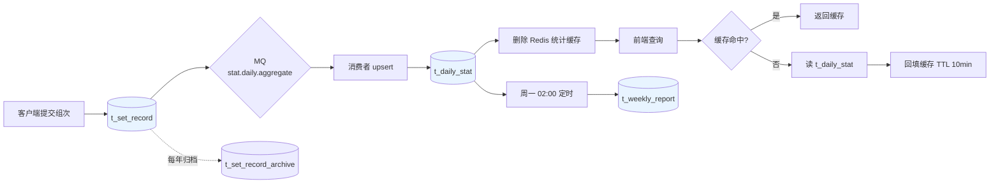

**流转说明**：写入只落 `t_set_record`（单表插入，最快路径）；聚合由消费者异步 upsert 到 `t_daily_stat`；缓存**不随写入更新，而是删除**（Cache-Aside），下一次读回填；周报由定时任务基于日聚合汇总生成快照；归档按年把明细搬入归档表。

### 4.6 一致性方案

| 场景 | 一致性要求 | 实现机制 | 失败补偿 |
|------|-----------|---------|---------|
| 组次记录 → 日聚合 | **最终一致**（≤5s） | 本地事务写记录 + 发 MQ；消费端按 (member_id, stat_date) upsert 幂等 | 消息发送失败：写入 `t_outbox`（本地消息表），定时任务补发；消费失败：重试 3 次后进死信，每日重放 |
| 模板下架 → 历史计划 | **强一致（快照隔离）** | 计划保存 `snapshot_json`，不依赖模板实时状态 | 无需补偿（快照即结果） |
| 审核决定 → 上架状态 | **强一致** | 审核工单与对象状态在同一本地事务内更新；乐观锁 `version` 防并发 | 冲突返回 409，前端刷新重试 |
| 授权收回 → 教练可见性 | **强一致** | 每次查询实时校验 `t_coach_authorization.status + expire_at`，**不使用缓存授权结果** | 无（实时校验，天然一致） |
| 计划周次推进 | **最终一致** | 定时任务按 `start_date` 计算 `current_week`，幂等更新 | 任务失败：次日补偿；重复执行无副作用（按日期计算而非 +1） |

**幂等设计**

| 场景 | 幂等键 | 存放位置 | 去重方式 |
|------|-------|---------|---------|
| 组次重复提交 | `client_token`（客户端生成 UUID） | `t_set_record.client_token` UNIQUE | 插入冲突 → 查询已有记录并返回 |
| 消息重复消费 | `event_id`（业务主键 + 版本，如 `SET:12345:v1`） | `t_event_consume_log.event_id` UNIQUE | 冲突即跳过，返回成功 |
| 日聚合重复执行 | 复合主键 `(member_id, stat_date)` | `t_daily_stat` PK | `INSERT ... ON DUPLICATE KEY UPDATE` 覆盖为最新值 |
| 周报重复生成 | `(member_id, week_start)` UNIQUE | `t_weekly_report` | upsert，后生成覆盖先生成 |
| 计划推进重复执行 | 由 `start_date` 推导，不使用自增计数 | `t_plan.start_date` | 天然幂等 |

### 4.7 缓存设计

| 缓存对象 | Key 设计 | 粒度 | 过期策略 | 更新时机 |
|---------|---------|------|---------|---------|
| 用户容量趋势 | `stat:tonnage:{memberId}:{from}:{to}:{gran}` | 单用户 + 时间窗 + 粒度 | TTL 10min | 聚合消费后**删除**该用户相关 key |
| 周报 | `report:weekly:{memberId}:{weekStart}` | 单用户单周 | TTL 24h | 周报重新生成时删除 |
| 动作库列表 | `exercise:list:{muscleGroup}` | 按肌群分组（全量约 6 个 key） | TTL 1h | 动作库变更时删除全部 `exercise:*` |
| 当前计划 | `plan:current:{memberId}` | 单用户 | TTL 5min | 计划激活/调整时删除 |
| 教练授权（**刻意不缓存**） | — | — | — | 每次实时校验，安全性优先（见 §4.6） |

**缓存三问**

- **穿透**（查不存在的 key，反复打库）：动作类不存在 ID 用空值缓存（TTL 60s）兜底；统计类查询限定"只查本人"，非法 ID 直接 403 不落库。
- **击穿**（热点 key 过期瞬间大量请求打库）：单用户统计 key 天然分散，不做特殊处理；动作库全量 key 用**逻辑过期 + 互斥重建**（只有一个请求去回填，其余等待）。
- **雪崩**（大量 key 同时过期）：TTL 加随机抖动（±10%）；缓存不可用时降级为直接读 `t_daily_stat`（数据源本身轻量），不返回错误。

> 一致性取舍：统计缓存允许"最多 10 分钟滞后"，这是**刻意接受**的最终一致（NFR 未要求实时）；但授权判断**绝不缓存**，因为越权是零容忍项（NFR-04）。这个取舍直接对应 §1.4 的质量属性优先级。

### 4.8 数据安全与合规

| 项目 | 措施 |
|------|------|
| 密码存储 | BCrypt（cost 10）加盐哈希；禁止明文/MD5/SHA1 |
| 手机号 | 存储加密（AES-GCM，密钥走环境变量）；展示与导出脱敏为 `138****0000` |
| 身体数据 | 属敏感个人信息：教练按授权 scope 可见，管理员**不可见**；导出需二次确认并记录 |
| 备份策略 | 每日全量（mysqldump）+ binlog 增量；保留 7 天；RPO = 24h，RTO = 2h |
| 访问控制 | 应用层三段式（角色 → 资源归属 → 授权关系）+ 数据访问层强制注入过滤条件 |
| 日志留存 | 操作日志（审核、授权、导出）保留 1 年，只记操作不记明细；应用日志 30 天轮转 |
| 传输安全 | 全站 HTTPS；内网服务间本期不加密（单体部署）；Cookie 加 `HttpOnly/SameSite` |
| 越权防护 | 统一 403 且不区分"不存在/无权限"；敏感接口二次校验资源归属 |

### 4.9 本节自检

- [ ] ER ≥10 实体，数据字典 ≥10 张表
- [ ] ER 图与实际建表脚本**完全一致**
- [ ] 有缓存设计与一致性方案
- [ ] 敏感数据有明确处理措施

---

## 5 开发架构视图（Development View）

> 关注点：代码如何组织？如何构建、测试、发布？

### 5.1 技术栈选型

| 层次 | 技术 | 版本 | 选型理由 | 被否决的备选及原因 |
|------|------|------|---------|------------------|
| 前端 | | | | |
| 后端 | | | | |
| 数据库 | | | | |
| 缓存 | | | | |
| 消息 | | | | |
| 构建 | | | | |
| 测试 | | | | |

### 5.2 源码目录结构

```
03-源码/
├── backend/
│   ├── controller/     # 接入层：参数校验、路由、异常转译
│   ├── application/    # 应用层：用例编排、事务边界
│   ├── domain/         # 领域层：实体、值对象、领域服务
│   ├── infrastructure/ # 基础设施层：持久化实现
│   └── config/         # 配置
├── frontend/
└── docs/api/openapi.yaml
```

**目录职责说明**

| 目录 | 职责 | 对应逻辑视图的哪一层 / 哪个模块 |
|------|------|---------------------------|
| | | |

> 评审重点：目录结构必须能映射回第 3 章的分层与模块划分。

### 5.3 模块依赖图

**图 5-1 模块编译期依赖**

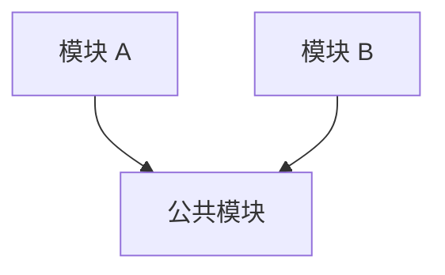

| 禁止的依赖方向 | 理由 |
|--------------|------|
| | |

### 5.4 第三方依赖清单

| 依赖 | 版本 | 用途 | 许可证 | 备注 |
|------|------|------|-------|------|
| | | | | |

### 5.5 配置与环境管理

| 环境 | 用途 | 数据库 | 域名 | 配置来源 |
|------|------|-------|------|---------|
| dev | | | | |
| test | | | | |
| prod | | | | |

**密钥管理**：【禁止明文入库，说明用环境变量 / 配置中心 / 密钥文件】

### 5.6 构建与 CI/CD

**图 5-2 流水线**


| 阶段 | 工具 | 卡点（失败即中断） |
|------|------|------------------|
| | | |

### 5.7 编码规范与质量门禁

| 项 | 规范 |
|----|------|
| 命名 | 类名大驼峰、方法小驼峰、常量全大写 |
| 异常 | 统一业务异常 + 全局处理器，禁止吞异常 |
| 日志 | Slf4J，禁止 `System.out.println`，禁止打印敏感信息 |
| 事务 | 仅标注在应用层方法 |
| 注释 | 公开方法必须有 Javadoc |
| 单测覆盖率 | ≥ ____% |

### 5.8 版本管理策略

- 分支模型：【Git Flow / Trunk Based / GitHub Flow】
- 提交信息：Conventional Commits（`feat/fix/docs/refactor/test/chore`）
- 版本号：语义化版本 `MAJOR.MINOR.PATCH`

### 5.9 测试策略

| 层级 | 占比 | 工具 | 示例 |
|------|------|------|------|
| 单元测试 | 70% | | |
| 集成测试 | 20% | | |
| 端到端 | 10% | | |

### 5.10 AI 辅助开发方案与 Skill 包

| 环节 | 是否使用 AI | 说明 |
|------|-----------|------|
| 代码骨架生成 | 是 | 由 Skill 约束分层与命名 |
| 文档撰写 | | |
| 图表绘制 | | |
| 调试排错 | | |

| Skill 名称 | 触发场景 | 强制约束 | 附带资产 |
|-----------|---------|---------|---------|
| project-scaffold | 初始化 / 还原项目结构 | 目录与配置规范 | `scripts/` |
| module-generator | 新增业务模块 | R-01 ~ R-04 | `templates/` `scripts/` |
| arch-doc-sync | 代码 → 文档同步 | 目录 / 接口与文档一致 | `scripts/` |

> 详细要求见任务书第五章；Skill 中写死的规范必须与 5.2、5.7 **完全一致**。

### 5.11 本节自检

- [ ] 目录结构与第 3 章分层 / 模块一一对应
- [ ] 有 CI 流程与质量门禁
- [ ] 有测试策略且可运行
- [ ] Skill 约束 = 本节规范

---

## 6 运行架构视图（Runtime / Process View）

> 关注点：运行时有哪些进程/服务？如何通信、并发、容错？性能与容量如何？

### 6.1 运行时进程视图

| 进程/服务 | 职责 | 实例数 | 端口 | 通信协议 | 资源占用 |
|----------|------|-------|------|---------|---------|
| | | | | | |

### 6.2 并发与线程模型

- 请求链路：【如 Tomcat 线程池 → Service → HikariCP 连接池】
- 关键参数：线程池核心/最大 = 【__/__】；连接池 = 【__】
- 阻塞边界：【哪些操作阻塞线程，如何处理】

### 6.3 关键运行时场景（≥3 个，且与 3.6 不重复）

**图 6-1 并发场景**　**图 6-2 异步任务**　**图 6-3 缓存失效重建 / 服务降级**

### 6.4 核心对象状态机（对应任务书 C2）

**核心对象一：训练模板审核流（对应任务书 C2 的"审批流"）**

**图 6-4 模板 / 教练资质审核状态机**

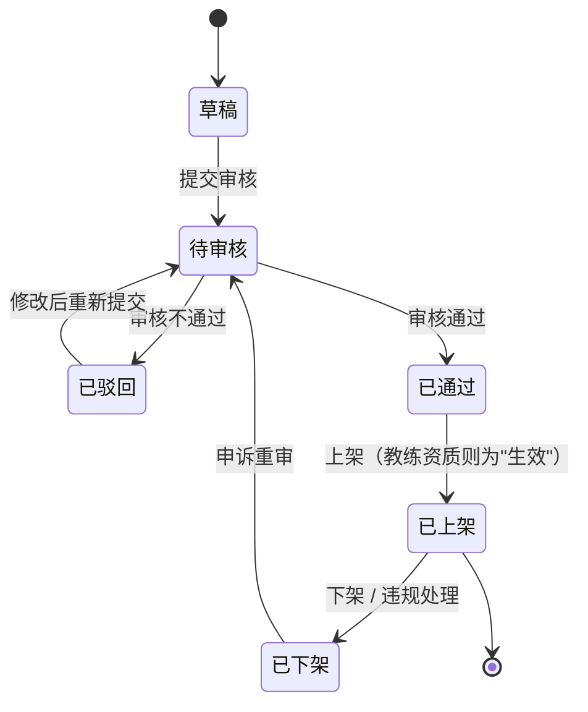

| 状态 | 可迁移到 | 触发条件 | 副作用 |
|------|---------|---------|-------|
| 草稿 | 待审核 | 作者提交 | 生成审核任务，通知管理员 |
| 待审核 | 已通过 / 已驳回 | 管理员操作 | 写审核记录（审核人、意见、时间） |
| 已驳回 | 待审核 | 作者修改后重提 | 保留历史审核意见，版本号 +1 |
| 已通过 | 已上架 | 管理员/系统自动上架 | 进入可被其他用户复用的库 |
| 已上架 | 已下架 | 管理员下架或作者撤回 | 已引用该模板的计划**不受影响**（快照隔离） |

> 关键设计：计划引用模板时保存**快照**，因此模板下架不会破坏历史计划 —— 这条约束会反过来影响数据视图（§4）的表设计，属于"视图之间互相修正"的真实案例（用于回答 §8.2 问题 1）。

**核心对象二：训练计划实例生命周期**

| 状态 | 可迁移到 | 触发条件 | 副作用 |
|------|---------|---------|-------|
| 草稿 | 进行中 | 用户激活 / 计划开始日到达 | 生成该周期的训练日清单 |
| 进行中 | 已完成 | 末阶段全部训练日结束 | 结算达成率，触发周报/月报 |
| 进行中 | 已中止 | 用户主动中止 / 连续 14 天未打卡 | 冻结统计口径，数据保留 |
| 已完成 | — | 终态 | — |

### 6.5 异步与消息设计（对应任务书 C3）

| 主题/队列 | 生产者 | 消费者 | 投递语义 | 重试策略 | 死信处理 |
|----------|-------|-------|---------|---------|---------|
| `stat.daily.aggregate` | 打卡服务 | 统计聚合消费者 | 至少一次 | 指数退避 3 次（1s/5s/30s） | 死信队列 + 每日人工重放 |
| `report.weekly.generate` | 定时任务（周一 02:00） | 周报生成消费者 | 至少一次 | 3 次后告警 | 死信 + 支持按用户重算 |
| `notify.audit.result` | 审核服务 | 通知消费者（站内信/邮件） | 至少一次 | 5 次 | 死信，落库待补发 |
| `plan.generate.async` | 计划服务 | 计划生成消费者（规则计算） | 至少一次 | 2 次，失败转为同步兜底 | 不适用（超时判失败） |

> 幂等设计：所有消费者以 `事件ID（业务主键 + 版本）` 作为幂等键写入 `t_event_consume_log`，重复投递直接丢弃。
> 排队与削峰：打卡写入是高频路径，聚合通过消息解耦，避免统计逻辑拖慢记录接口（对应 NFR-02 的 5s 目标）。

### 6.6 性能与容量估算

**假设**：DAU = ____，峰值 QPS = ____，日增数据 = ____

```
峰值 QPS = DAU × 活跃比例 × 人均请求数 / 有效秒数
        = ____ × ____ × ____ / ____
        = ____ QPS
单实例处理能力 = ____ QPS
所需实例数 = ceil(峰值 QPS / 单实例能力 × 冗余系数) = ____
```

**瓶颈点**：【____】　**优化手段**：【____】

### 6.7 并发控制方案

| 冲突场景 | 方案 | 具体实现 | 失败后行为 |
|---------|------|---------|-----------|
| | 乐观锁 / 分布式锁 / 唯一约束 / 幂等表 | | |

### 6.8 容错、降级与限流

| 机制 | 应用位置 | 阈值 | 触发后行为 |
|------|---------|------|-----------|
| 超时 | | | |
| 重试 | | | |
| 熔断 | | | |
| 降级 | | | |
| 限流 | | | |

### 6.9 可观测性

| 类别 | 内容 |
|------|------|
| 日志 | 分级规范、traceId 贯穿、敏感信息脱敏 |
| 指标 | QPS / 响应时间 / 错误率 / 队列长度 |
| 链路追踪 | |
| 告警规则 | |

### 6.10 安全运行机制

| 项 | 方案 |
|----|------|
| 认证 | JWT / Session / OAuth2 |
| 鉴权 | RBAC，拦截位置 = ____ |
| 防重放 | |
| 防注入 | 预编译参数绑定 |
| 传输安全 | HTTPS |

### 6.11 本节自检

- [ ] 运行视图与逻辑视图不重复
- [ ] 有状态机、容量估算（带公式）
- [ ] 有并发冲突解决方案
- [ ] 有限流降级熔断

---

## 7 物理架构视图（Physical View）

> 关注点：软件如何映射到硬件与网络？如何部署、扩容、容灾？

### 7.1 部署拓扑图

**图 7-1 部署拓扑**

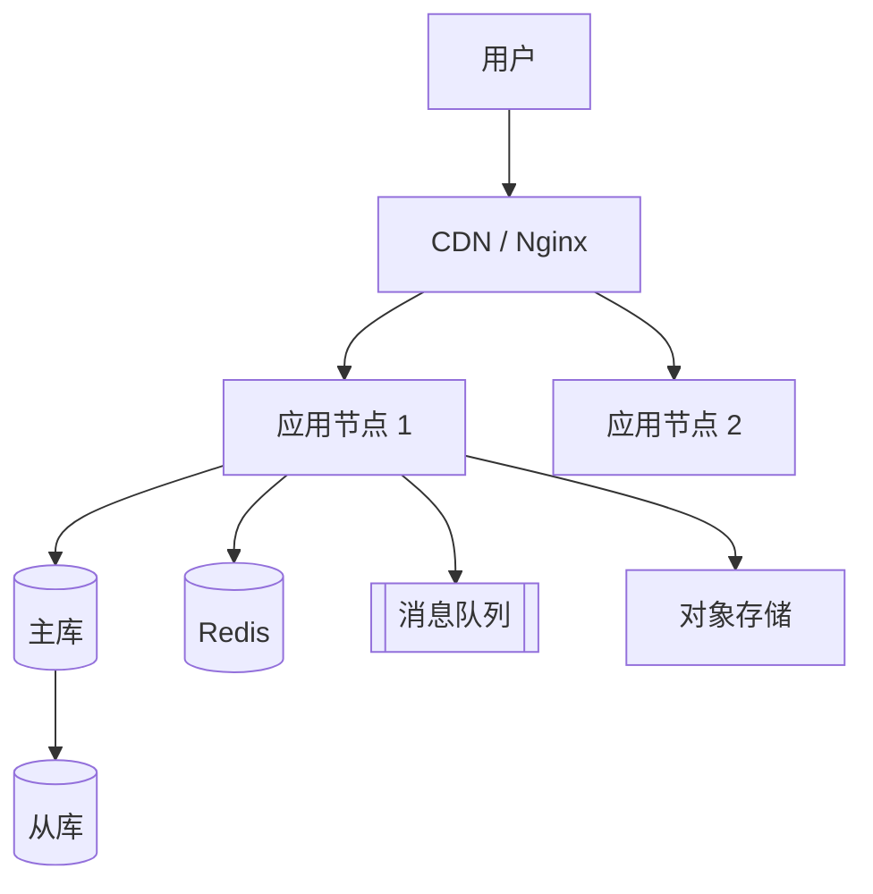

### 7.2 节点与资源配置清单

| 节点 | 角色 | CPU | 内存 | 磁盘 | 带宽 | OS | 软件版本 |
|------|------|-----|------|------|------|-----|---------|
| | | | | | | | |

### 7.3 网络与安全域

| 安全域 | 内容 | 开放端口 | 访问来源 |
|-------|------|---------|---------|
| 公网区 | | 80/443 | 任意 |
| 应用区 | | | 仅内网 |
| 数据区 | | | 仅应用区 |

- HTTPS 终止位置：【CDN / Nginx / 应用】
- 防火墙与 WAF 策略：【____】

### 7.4 部署方案与制品

| 制品 | 构建方式 | 镜像大小 | 配置注入方式 |
|------|---------|---------|-------------|
| | | | |

**部署命令**：见 `03-源码/docker-compose.yml`

### 7.5 高可用与容灾

| 组件 | 是否单点 | 消除方式 | 故障转移时间 |
|------|---------|---------|-------------|
| | | | |

- RTO = 【____】；RPO = 【____】
- 备份策略与恢复演练：【____】

### 7.6 环境规划

| 环境 | 资源规模 | 数据来源 | 说明 |
|------|---------|---------|------|
| dev | | 造数 | |
| test | | 脱敏数据 | |
| prod | | 真实数据 | |

### 7.7 扩容策略

| 组件 | 扩容方式 | 触发条件 | 操作步骤 | 难点 |
|------|---------|---------|---------|------|
| 无状态应用 | 水平 | CPU > 70% 持续 5min | | 无 |
| 数据库 | | | | 有状态，需主从切换 |

### 7.8 成本估算

| 资源 | 规格 | 数量 | 单价（月） | 小计 |
|------|------|------|-----------|------|
| | | | | |
| **合计** | | | | **￥____** |

**预算约束下的取舍**：【放弃了什么，为什么可以接受】

### 7.9 实际部署验证

| 项 | 内容 |
|----|------|
| 访问地址 | |
| 部署方式 | Docker Compose / K8s / 手工 |
| 部署耗时 | |
| 过程记录 | 见附录 / screenshots/ |
| 监控日志截图 | 见 `04-演示/screenshots/` |

### 7.10 本节自检

- [ ] 部署图包含完整链路（客户端→负载→应用→数据→中间件）
- [ ] 有资源清单与成本估算
- [ ] 单点已消除或明确说明为何保留
- [ ] 实际可访问

---

## 8 五视图一致性追溯

### 8.1 追溯矩阵（≥10 条核心需求）

| 需求 ID | 需求描述 | 逻辑单元 | 数据实体 | 代码模块 | 运行时进程 | 部署节点 | 对应 ADR |
|---------|---------|---------|---------|---------|-----------|---------|---------|
| FR-01 | | | | | | | |
| FR-02 | | | | | | | |
| … | | | | | | | |

### 8.2 三个必答问题

**问题 1：哪个视图的约束反过来修改了另一个视图的决策？**

【答：在绘制 ____ 视图时发现 ____ 冲突，于是在 ____ 视图中改为 ____，这又导致 ____ 视图的 ____ 调整。】

**问题 2：最高优先级质量属性在五个视图中如何体现？**

| 视图 | 该质量属性的体现 |
|------|----------------|
| 逻辑 | |
| 数据 | |
| 开发 | |
| 运行 | |
| 物理 | |

**问题 3：用户量增长 10 倍，最小变更集？**

| 视图 | 需改动的部分 | 工作量 |
|------|------------|-------|
| | | |

---

## 附录 A：ADR 明细

见 [`adr/`](adr/) 目录，共 8 条，模板见任务书附录 B。

## 附录 B：图例与建模约定

- 建模语言：【UML 2.5 / C4】　绘图工具：【Mermaid / draw.io】
- 图形约定：实线箭头 = 依赖；虚线 = 异步消息

## 附录 C：核心代码索引

| 架构元素 | 代码位置 | 说明 |
|---------|---------|------|
| 分层边界 | `03-源码/backend/controller/` | |
| 领域模型 | | |
| 状态机实现 | | |
| 缓存实现 | | |
| 消息生产者 | | |

> 这张表是答辩"代码走查"环节的索引，用来证明文档与代码一致。

## 附录 D：参考文献（≥10 篇，近三年 ≥4 篇，英文 ≥2 篇）

1. Len Bass 等.《软件架构实践》（第 4 版）
2. 李运华.《从零开始学架构》
3. Simon Brown.《Software Architecture for Developers》— C4 模型
4. Martin Fowler. *Patterns of Enterprise Application Architecture*
5. IEEE 1471 / ISO-IEC-IEEE 42010《架构描述》
6. 【待补充】