# 《【项目名称】》架构设计说明书

| 项目 | 内容 |
|------|------|
| 系统名称 | 【待填写】 |
| 版本 | V0.1（初稿） |
| 组队形式 | 【个人 / 2 人 / 3 人】 |
| 学号 / 姓名 | 【待填写】 |
| 完成日期 | 【待填写】 |
| 在线访问地址 | 【待填写】 |
| 测试账号 | 角色 / 账号 / 密码：【待填写】 |
| 源码仓库 | https://github.com/Greenkiller-Cyber/software |

**修订记录**（至少 3 个版本，体现设计演进过程）

| 版本 | 日期 | 修订人 | 修订内容 |
|------|------|--------|---------|
| V0.1 | | | 初稿：需求与逻辑视图 |
| V0.5 | | | 补充数据/开发视图 |
| V1.0 | | | 定稿 |

> **写作约定**：全文统一使用【UML 2.5 / C4 模型】，绘图工具【Mermaid / draw.io】。
> 每图必须有编号 + 图题，正文必须解读；每个「自检」小节定稿前逐条核对并勾选。

---

## 1 需求概述

### 1.1 项目背景与目标

【3–5 段：为谁解决什么问题、现有方案为何不够、系统边界（做什么、不做什么）】

**系统目标**（须可验证）

1. 【目标 1，如"预约创建接口 P95 ≤ 300ms"】
2. 【目标 2】
3. 【目标 3】

**系统边界（不做的事）**

- 不做【____】
- 不做【____】

### 1.2 用户角色

| 角色 | 描述 | 核心诉求 | 关键权限差异（数据可见性 / 操作权限） |
|------|------|---------|-------------------------------|
| | | | |

> 硬性要求：个人 ≥2 类角色，2 人 / 3 人小组 ≥3 类，且必须体现**数据可见性**差异，不只是菜单差异。

### 1.3 功能需求清单

| 需求 ID | 一级模块 | 子功能 | 优先级 | 涉及角色 | 复杂度类别 |
|---------|---------|--------|-------|---------|-----------|
| FR-01 | | | 高/中/低 | | C1/C2/C3/C4 |

> 硬性要求：一级模块 ≥6（个人）/ ≥7（2 人）/ ≥8（3 人），每模块 ≥3 个子功能。
> 复杂度类别对应任务书 2.3 节 C1–C4，每条需求至少标注一项。

**图 1-1 功能模块树**

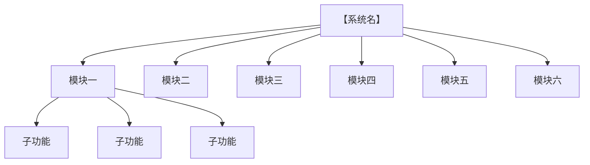

### 1.4 非功能需求（质量属性场景）

采用「刺激—响应—度量」三段式，**必须可度量**。

| ID | 质量属性 | 场景描述 | 度量指标 | 目标值 |
|----|---------|---------|---------|-------|
| NFR-01 | 性能 | 正常负载下提交【XX】请求 | 响应时间 P95 | ≤ 500ms |
| NFR-02 | 可用性 | 任意单节点故障 | 服务可用性 | ≥ 99.5% |
| NFR-03 | 可扩展性 | 新增一个业务模块 | 需改动文件数 | ≤ 5 |
| NFR-04 | 安全性 | 未登录访问受保护接口 | 拦截率 | 100% |
| NFR-05 | 可维护性 | 定位一次线上故障 | MTTR | ≤ 30min |

**质量属性优先级**（最多 3 项，贯穿五视图）：

1. 【______】——理由：【______】
2. 【______】——理由：【______】

### 1.5 约束与假设

| 类型 | 内容 |
|------|------|
| 技术约束 | |
| 资源约束 | |
| 时间约束 | 14 周，课余时间 |
| 合规约束 | |
| 假设 | 如：日活不超过 5000、不考虑国际化 |

---

## 2 架构总览

### 2.1 架构目标与策略

| 最高优先级质量属性 | 采用的架构策略 | 体现在哪些视图 |
|------------------|--------------|--------------|
| | | 逻辑 / 数据 / 开发 / 运行 / 物理 |

### 2.2 架构风格选择

**选定风格**：【分层 / 微服务 / 事件驱动 / CQRS / 管道-过滤器 / 微内核】

| 候选风格 | 优点（针对本项目） | 缺点 | 是否采用 |
|---------|-----------------|------|---------|
| | | | |
| | | | |

> 必须同时回答"为什么不用更简单的"和"为什么不用更复杂的"。选微服务必须论证规模真的需要。

### 2.3 系统上下文图

**图 2-1 系统上下文**

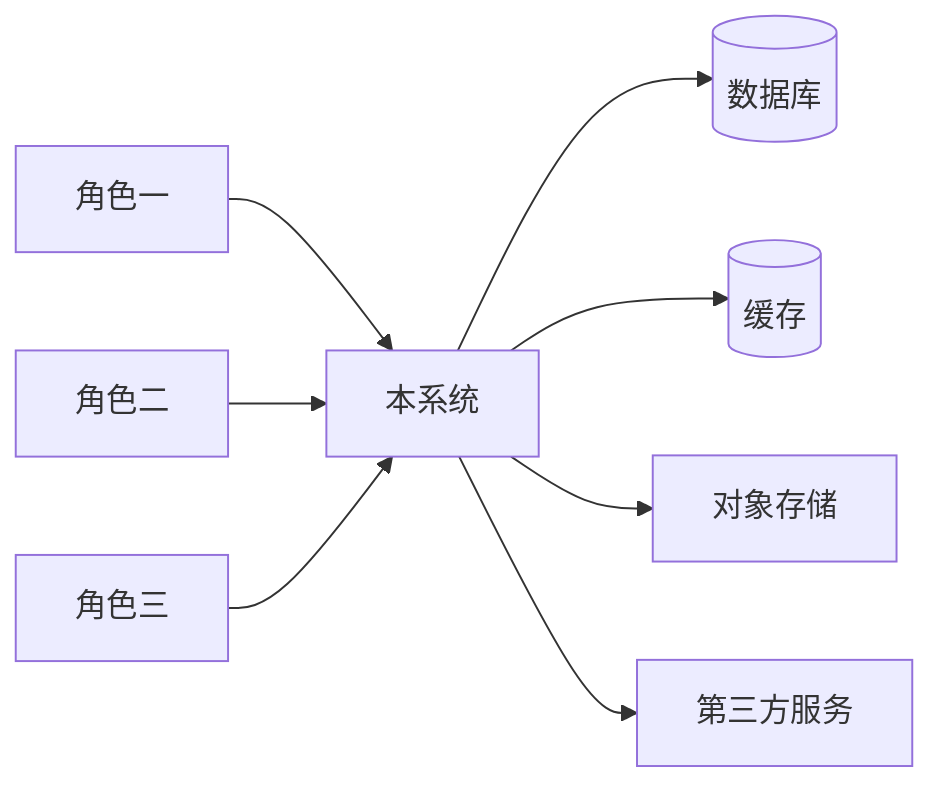

**外部系统清单**

| 外部系统 | 交互方式 | 数据流向 | 失败时的降级策略 |
|---------|---------|---------|----------------|
| | | | |

### 2.4 架构决策记录（ADR）汇总

| ADR 编号 | 决策主题 | 状态 | 涉及视图 |
|---------|---------|------|---------|
| [ADR-001](adr/ADR-001-后端框架选型.md) | 后端框架选型 | 提案 | 开发 / 运行 |
| [ADR-002](adr/ADR-002-前端框架选型.md) | 前端框架选型 | 提案 | 开发 |
| [ADR-003](adr/ADR-003-数据存储选型.md) | 数据存储选型 | 提案 | 数据 |
| [ADR-004](adr/ADR-004-缓存策略.md) | 缓存策略 | 提案 | 数据 / 运行 |
| [ADR-005](adr/ADR-005-认证授权方案.md) | 认证授权方案 | 提案 | 逻辑 / 运行 |
| [ADR-006](adr/ADR-006-部署形态.md) | 部署形态 | 提案 | 物理 |
| [ADR-007](adr/ADR-007-异步与消息机制.md) | 异步与消息机制 | 提案 | 运行 |
| [ADR-008](adr/ADR-008-模块划分方式.md) | 模块划分方式 | 提案 | 逻辑 / 开发 |

> 硬性要求：≥8 条，明细见 `adr/` 目录。

---

## 3 逻辑架构视图（Logical View）

> 关注点：为终端用户提供什么功能？如何划分为职责内聚的单元？单元之间如何协作？

### 3.1 功能结构图

**图 3-1 功能结构（展开到子功能，标注重点实现模块）**

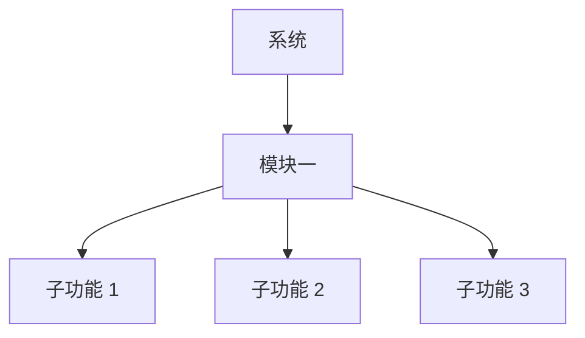

### 3.2 容器 / 子系统划分（C4-Container）

**图 3-2 容器视图**

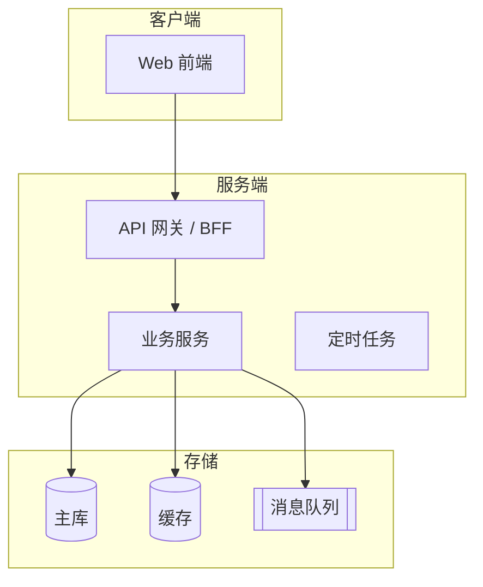

| 容器 | 职责 | 技术选型 | 通信协议 |
|------|------|---------|---------|
| | | | |

### 3.3 分层架构与依赖规则

**图 3-3 分层与依赖方向**

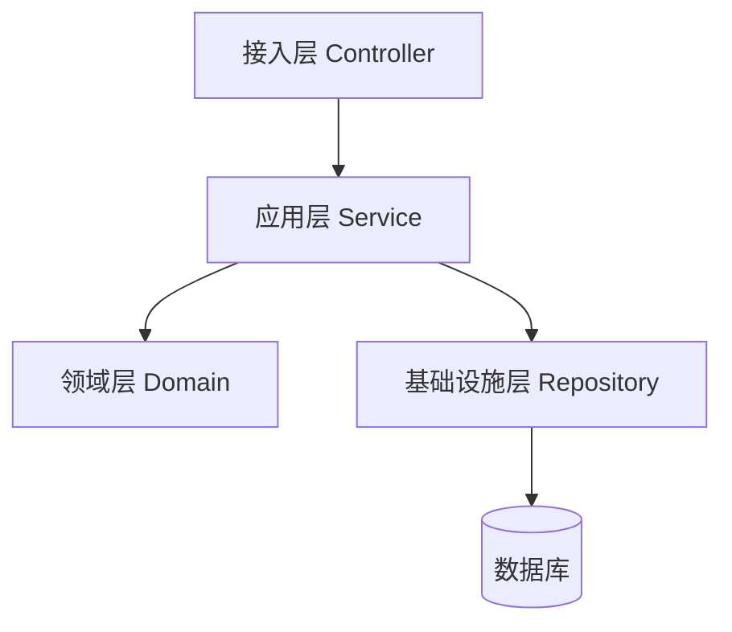

**依赖规则（这些规则将原样写进 Skill，是逻辑视图与 Skill 的一致性锚点）**

| 规则 ID | 内容 | 检查方式 |
|---------|------|---------|
| R-01 | 禁止 Controller 直接调用 Repository | `check-layering.py` / Review |
| R-02 | 禁止领域层依赖 Web 框架注解 | `check-layering.py` |
| R-03 | 禁止同层之间横向调用 | Review |
| R-04 | 禁止基础设施层反向依赖应用层 | `check-layering.py` |

### 3.4 领域模型 / 核心类图（≥8 个实体）

**图 3-4 核心领域模型**

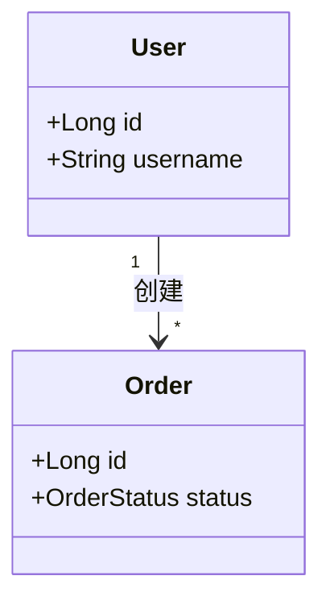

| 实体 | 含义 | 关键属性 | 与其他实体的关系 |
|------|------|---------|----------------|
| | | | |

### 3.5 关键接口定义（≥5 个）

| 接口 ID | 接口名 | 签名 | 前置条件 | 后置条件 | 异常约定 |
|---------|-------|------|---------|---------|---------|
| IF-01 | | | | | |

### 3.6 关键场景时序图（≥3 个）

> 必须覆盖：一个跨模块、一个含外部系统调用、一个失败/异常流程。

**图 3-5 场景 1：跨模块**

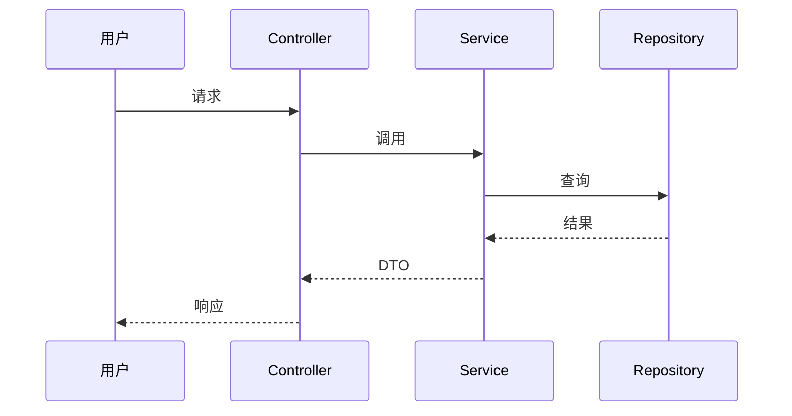

**图 3-6 场景 2：含外部系统调用**　**图 3-7 场景 3：异常 / 失败流程**

### 3.7 模块职责与依赖矩阵

| 模块 | 职责 | 依赖的模块 | 被谁依赖 | 对外接口数 |
|------|------|-----------|---------|-----------|
| | | | | |

**循环依赖检查结论**：【通过 / 存在环：A→B→C→A，已通过 ____ 消除】

### 3.8 本节自检

- [ ] 一级模块 ≥6 个，职责内聚、边界清晰
- [ ] 无反向依赖、无跨层调用
- [ ] 类图实体与第 4 章 ER 图一致
- [ ] 时序图覆盖跨模块 / 外部系统 / 异常流程
- [ ] 依赖矩阵无环

---

## 4 数据架构视图（Data View）

> 关注点：数据如何组织、存储、流转、一致化与保护？

### 4.1 ER 图（≥10 个实体）

**图 4-1 ER 图**

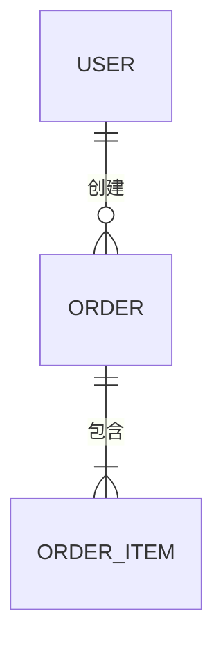

### 4.2 数据字典（核心表 ≥10 张）

**表 4-1 t_xxx（中文名）**

| 字段 | 类型 | 长度 | 约束 | 默认值 | 业务含义 |
|------|------|------|------|-------|---------|
| id | BIGINT | — | PK, 自增 | — | 主键 |
| created_at | DATETIME | — | NOT NULL | CURRENT_TIMESTAMP | 创建时间 |

> 每张核心表一张此表；字段说明写业务含义，不能只写名称。

### 4.3 存储选型矩阵

| 数据类别 | 举例 | 存储方案 | 选型理由 | 被否决的备选 |
|---------|------|---------|---------|-------------|
| 结构化业务数据 | 订单、用户 | | | |
| 高频读数据 | 首页配置 | | | |
| 文件 | 图片、附件 | | | |
| 检索数据 | 全文搜索 | | | |

### 4.4 数据分布与读写策略

| 策略 | 本期是否实现 | 触发条件（什么量级启用） | 预留设计 |
|------|------------|------------------------|---------|
| 读写分离 | | | |
| 分库分表 | | | |
| 冷热分离 | | | |

### 4.5 数据流转图

**图 4-2 关键业务数据流转**（写入 → 同步 → 缓存失效 → 归档）

### 4.6 一致性方案

| 场景 | 一致性要求 | 实现机制 | 失败补偿 |
|------|-----------|---------|---------|
| 【如：下单扣库存】 | 强一致 / 最终一致 | 本地事务 / MQ + 幂等 | |

**幂等设计**：【幂等 Key 与去重表设计】

### 4.7 缓存设计

| 缓存对象 | Key 设计 | 粒度 | 过期策略 | 更新时机 |
|---------|---------|------|---------|---------|
| | | | | |

**缓存三问**：穿透→【____】；击穿→【____】；雪崩→【____】

### 4.8 数据安全与合规

| 项目 | 措施 |
|------|------|
| 密码存储 | BCrypt 加盐哈希 |
| 敏感字段 | 【脱敏 / 加密方式】 |
| 备份策略 | 全量 / 增量周期，RPO = ____，RTO = ____ |
| 访问控制 | |
| 日志留存 | |

### 4.9 本节自检

- [ ] ER ≥10 实体，数据字典 ≥10 张表
- [ ] ER 图与实际建表脚本**完全一致**
- [ ] 有缓存设计与一致性方案
- [ ] 敏感数据有明确处理措施

---

## 5 开发架构视图（Development View）

> 关注点：代码如何组织？如何构建、测试、发布？

### 5.1 技术栈选型

| 层次 | 技术 | 版本 | 选型理由 | 被否决的备选及原因 |
|------|------|------|---------|------------------|
| 前端 | | | | |
| 后端 | | | | |
| 数据库 | | | | |
| 缓存 | | | | |
| 消息 | | | | |
| 构建 | | | | |
| 测试 | | | | |

### 5.2 源码目录结构

```
03-源码/
├── backend/
│   ├── controller/     # 接入层：参数校验、路由、异常转译
│   ├── application/    # 应用层：用例编排、事务边界
│   ├── domain/         # 领域层：实体、值对象、领域服务
│   ├── infrastructure/ # 基础设施层：持久化实现
│   └── config/         # 配置
├── frontend/
└── docs/api/openapi.yaml
```

**目录职责说明**

| 目录 | 职责 | 对应逻辑视图的哪一层 / 哪个模块 |
|------|------|---------------------------|
| | | |

> 评审重点：目录结构必须能映射回第 3 章的分层与模块划分。

### 5.3 模块依赖图

**图 5-1 模块编译期依赖**

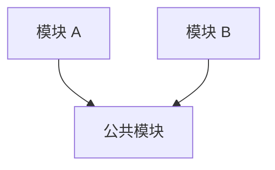

| 禁止的依赖方向 | 理由 |
|--------------|------|
| | |

### 5.4 第三方依赖清单

| 依赖 | 版本 | 用途 | 许可证 | 备注 |
|------|------|------|-------|------|
| | | | | |

### 5.5 配置与环境管理

| 环境 | 用途 | 数据库 | 域名 | 配置来源 |
|------|------|-------|------|---------|
| dev | | | | |
| test | | | | |
| prod | | | | |

**密钥管理**：【禁止明文入库，说明用环境变量 / 配置中心 / 密钥文件】

### 5.6 构建与 CI/CD

**图 5-2 流水线**


| 阶段 | 工具 | 卡点（失败即中断） |
|------|------|------------------|
| | | |

### 5.7 编码规范与质量门禁

| 项 | 规范 |
|----|------|
| 命名 | 类名大驼峰、方法小驼峰、常量全大写 |
| 异常 | 统一业务异常 + 全局处理器，禁止吞异常 |
| 日志 | Slf4J，禁止 `System.out.println`，禁止打印敏感信息 |
| 事务 | 仅标注在应用层方法 |
| 注释 | 公开方法必须有 Javadoc |
| 单测覆盖率 | ≥ ____% |

### 5.8 版本管理策略

- 分支模型：【Git Flow / Trunk Based / GitHub Flow】
- 提交信息：Conventional Commits（`feat/fix/docs/refactor/test/chore`）
- 版本号：语义化版本 `MAJOR.MINOR.PATCH`

### 5.9 测试策略

| 层级 | 占比 | 工具 | 示例 |
|------|------|------|------|
| 单元测试 | 70% | | |
| 集成测试 | 20% | | |
| 端到端 | 10% | | |

### 5.10 AI 辅助开发方案与 Skill 包

| 环节 | 是否使用 AI | 说明 |
|------|-----------|------|
| 代码骨架生成 | 是 | 由 Skill 约束分层与命名 |
| 文档撰写 | | |
| 图表绘制 | | |
| 调试排错 | | |

| Skill 名称 | 触发场景 | 强制约束 | 附带资产 |
|-----------|---------|---------|---------|
| project-scaffold | 初始化 / 还原项目结构 | 目录与配置规范 | `scripts/` |
| module-generator | 新增业务模块 | R-01 ~ R-04 | `templates/` `scripts/` |
| arch-doc-sync | 代码 → 文档同步 | 目录 / 接口与文档一致 | `scripts/` |

> 详细要求见任务书第五章；Skill 中写死的规范必须与 5.2、5.7 **完全一致**。

### 5.11 本节自检

- [ ] 目录结构与第 3 章分层 / 模块一一对应
- [ ] 有 CI 流程与质量门禁
- [ ] 有测试策略且可运行
- [ ] Skill 约束 = 本节规范

---

## 6 运行架构视图（Runtime / Process View）

> 关注点：运行时有哪些进程/服务？如何通信、并发、容错？性能与容量如何？

### 6.1 运行时进程视图

| 进程/服务 | 职责 | 实例数 | 端口 | 通信协议 | 资源占用 |
|----------|------|-------|------|---------|---------|
| | | | | | |

### 6.2 并发与线程模型

- 请求链路：【如 Tomcat 线程池 → Service → HikariCP 连接池】
- 关键参数：线程池核心/最大 = 【__/__】；连接池 = 【__】
- 阻塞边界：【哪些操作阻塞线程，如何处理】

### 6.3 关键运行时场景（≥3 个，且与 3.6 不重复）

**图 6-1 并发场景**　**图 6-2 异步任务**　**图 6-3 缓存失效重建 / 服务降级**

### 6.4 核心对象状态机（对应任务书 C2）

**图 6-4 状态机**

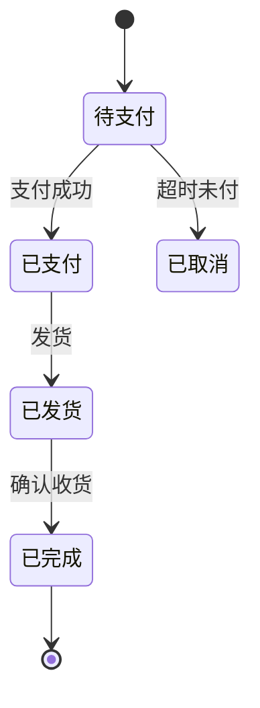

| 状态 | 可迁移到 | 触发条件 | 副作用 |
|------|---------|---------|-------|
| | | | |

### 6.5 异步与消息设计（对应任务书 C3）

| 主题/队列 | 生产者 | 消费者 | 投递语义 | 重试策略 | 死信处理 |
|----------|-------|-------|---------|---------|---------|
| | | | 至少一次 / 至多一次 | | |

### 6.6 性能与容量估算

**假设**：DAU = ____，峰值 QPS = ____，日增数据 = ____

```
峰值 QPS = DAU × 活跃比例 × 人均请求数 / 有效秒数
        = ____ × ____ × ____ / ____
        = ____ QPS
单实例处理能力 = ____ QPS
所需实例数 = ceil(峰值 QPS / 单实例能力 × 冗余系数) = ____
```

**瓶颈点**：【____】　**优化手段**：【____】

### 6.7 并发控制方案

| 冲突场景 | 方案 | 具体实现 | 失败后行为 |
|---------|------|---------|-----------|
| | 乐观锁 / 分布式锁 / 唯一约束 / 幂等表 | | |

### 6.8 容错、降级与限流

| 机制 | 应用位置 | 阈值 | 触发后行为 |
|------|---------|------|-----------|
| 超时 | | | |
| 重试 | | | |
| 熔断 | | | |
| 降级 | | | |
| 限流 | | | |

### 6.9 可观测性

| 类别 | 内容 |
|------|------|
| 日志 | 分级规范、traceId 贯穿、敏感信息脱敏 |
| 指标 | QPS / 响应时间 / 错误率 / 队列长度 |
| 链路追踪 | |
| 告警规则 | |

### 6.10 安全运行机制

| 项 | 方案 |
|----|------|
| 认证 | JWT / Session / OAuth2 |
| 鉴权 | RBAC，拦截位置 = ____ |
| 防重放 | |
| 防注入 | 预编译参数绑定 |
| 传输安全 | HTTPS |

### 6.11 本节自检

- [ ] 运行视图与逻辑视图不重复
- [ ] 有状态机、容量估算（带公式）
- [ ] 有并发冲突解决方案
- [ ] 有限流降级熔断

---

## 7 物理架构视图（Physical View）

> 关注点：软件如何映射到硬件与网络？如何部署、扩容、容灾？

### 7.1 部署拓扑图

**图 7-1 部署拓扑**

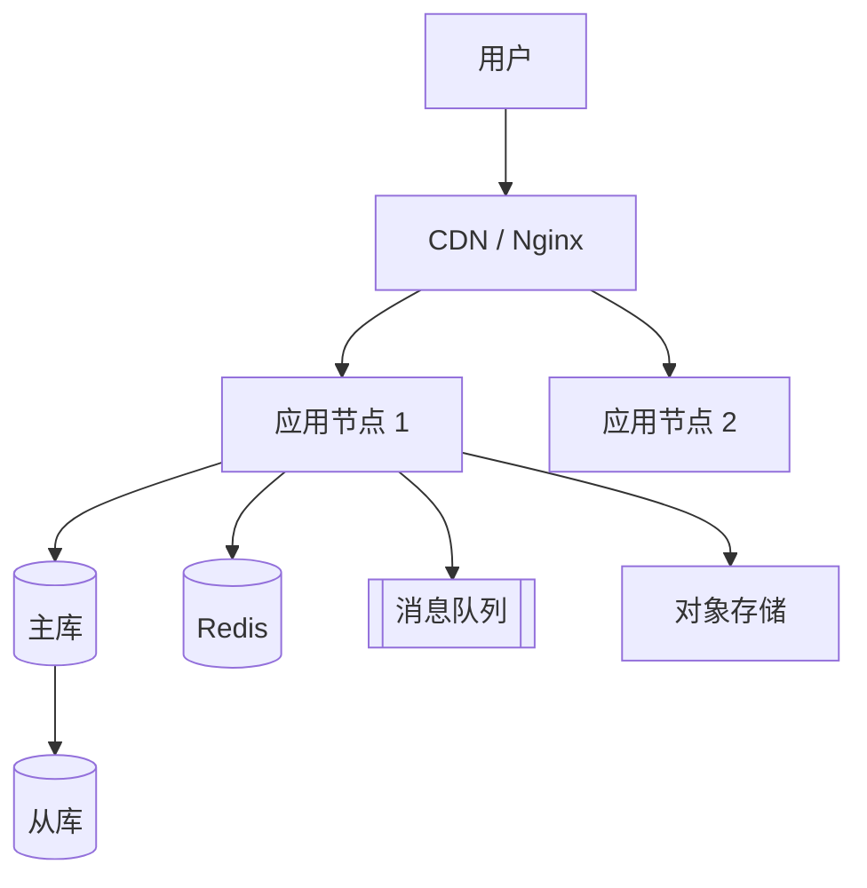

### 7.2 节点与资源配置清单

| 节点 | 角色 | CPU | 内存 | 磁盘 | 带宽 | OS | 软件版本 |
|------|------|-----|------|------|------|-----|---------|
| | | | | | | | |

### 7.3 网络与安全域

| 安全域 | 内容 | 开放端口 | 访问来源 |
|-------|------|---------|---------|
| 公网区 | | 80/443 | 任意 |
| 应用区 | | | 仅内网 |
| 数据区 | | | 仅应用区 |

- HTTPS 终止位置：【CDN / Nginx / 应用】
- 防火墙与 WAF 策略：【____】

### 7.4 部署方案与制品

| 制品 | 构建方式 | 镜像大小 | 配置注入方式 |
|------|---------|---------|-------------|
| | | | |

**部署命令**：见 `03-源码/docker-compose.yml`

### 7.5 高可用与容灾

| 组件 | 是否单点 | 消除方式 | 故障转移时间 |
|------|---------|---------|-------------|
| | | | |

- RTO = 【____】；RPO = 【____】
- 备份策略与恢复演练：【____】

### 7.6 环境规划

| 环境 | 资源规模 | 数据来源 | 说明 |
|------|---------|---------|------|
| dev | | 造数 | |
| test | | 脱敏数据 | |
| prod | | 真实数据 | |

### 7.7 扩容策略

| 组件 | 扩容方式 | 触发条件 | 操作步骤 | 难点 |
|------|---------|---------|---------|------|
| 无状态应用 | 水平 | CPU > 70% 持续 5min | | 无 |
| 数据库 | | | | 有状态，需主从切换 |

### 7.8 成本估算

| 资源 | 规格 | 数量 | 单价（月） | 小计 |
|------|------|------|-----------|------|
| | | | | |
| **合计** | | | | **￥____** |

**预算约束下的取舍**：【放弃了什么，为什么可以接受】

### 7.9 实际部署验证

| 项 | 内容 |
|----|------|
| 访问地址 | |
| 部署方式 | Docker Compose / K8s / 手工 |
| 部署耗时 | |
| 过程记录 | 见附录 / screenshots/ |
| 监控日志截图 | 见 `04-演示/screenshots/` |

### 7.10 本节自检

- [ ] 部署图包含完整链路（客户端→负载→应用→数据→中间件）
- [ ] 有资源清单与成本估算
- [ ] 单点已消除或明确说明为何保留
- [ ] 实际可访问

---

## 8 五视图一致性追溯

### 8.1 追溯矩阵（≥10 条核心需求）

| 需求 ID | 需求描述 | 逻辑单元 | 数据实体 | 代码模块 | 运行时进程 | 部署节点 | 对应 ADR |
|---------|---------|---------|---------|---------|-----------|---------|---------|
| FR-01 | | | | | | | |
| FR-02 | | | | | | | |
| … | | | | | | | |

### 8.2 三个必答问题

**问题 1：哪个视图的约束反过来修改了另一个视图的决策？**

【答：在绘制 ____ 视图时发现 ____ 冲突，于是在 ____ 视图中改为 ____，这又导致 ____ 视图的 ____ 调整。】

**问题 2：最高优先级质量属性在五个视图中如何体现？**

| 视图 | 该质量属性的体现 |
|------|----------------|
| 逻辑 | |
| 数据 | |
| 开发 | |
| 运行 | |
| 物理 | |

**问题 3：用户量增长 10 倍，最小变更集？**

| 视图 | 需改动的部分 | 工作量 |
|------|------------|-------|
| | | |

---

## 附录 A：ADR 明细

见 [`adr/`](adr/) 目录，共 8 条，模板见任务书附录 B。

## 附录 B：图例与建模约定

- 建模语言：【UML 2.5 / C4】　绘图工具：【Mermaid / draw.io】
- 图形约定：实线箭头 = 依赖；虚线 = 异步消息

## 附录 C：核心代码索引

| 架构元素 | 代码位置 | 说明 |
|---------|---------|------|
| 分层边界 | `03-源码/backend/controller/` | |
| 领域模型 | | |
| 状态机实现 | | |
| 缓存实现 | | |
| 消息生产者 | | |

> 这张表是答辩"代码走查"环节的索引，用来证明文档与代码一致。

## 附录 D：参考文献（≥10 篇，近三年 ≥4 篇，英文 ≥2 篇）

1. Len Bass 等.《软件架构实践》（第 4 版）
2. 李运华.《从零开始学架构》
3. Simon Brown.《Software Architecture for Developers》— C4 模型
4. Martin Fowler. *Patterns of Enterprise Application Architecture*
5. IEEE 1471 / ISO-IEC-IEEE 42010《架构描述》
6. 【待补充】