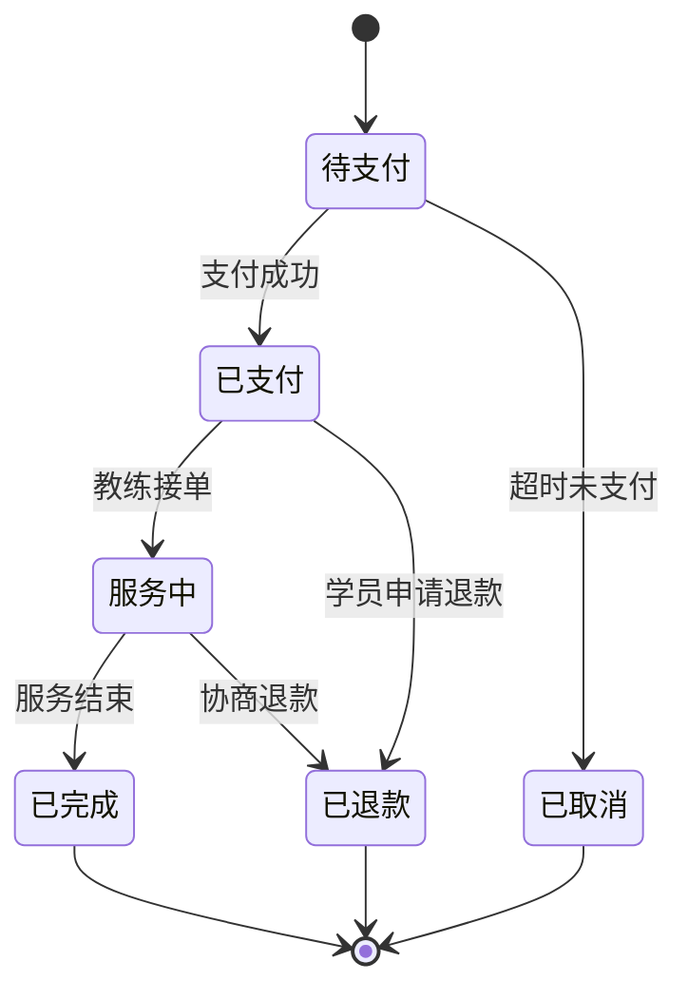

# 选题方案：健身运动方向（个人独立完成）

> 依据：任务书 2.2 个人组硬性指标 + 2.3 复杂度底线 C1–C4（个人需满足 ≥2 项）。
> 本文给出 3 个候选，逐个做复杂度映射与风险评估，最后给出推荐方案与模块划分草案。

## 0 约束回顾（个人组）

| 指标 | 要求 |
|------|------|
| 一级功能模块 | ≥6 个，每模块 ≥3 个子功能 |
| 角色 | ≥2 类（若声明 C1，则需 ≥3 类且体现**数据可见性**差异） |
| 复杂度场景 | C1–C4 至少满足 2 项 |
| 禁止 | 纯 CRUD 拆分、无后端、fork 开源改名、单用户博客类 |

> 关键判断：**"模块"的认定标准是职责内聚 + 逻辑视图对应独立包 + 模块间有明确接口**，四张表的增删改查只算 1 个模块。

---

## 候选 A：FitMate · 训练计划与执行管理（推荐）

**一句话定位**：为健身爱好者解决"不会安排训练、练了没反馈"的问题，通过可执行的周期化训练计划 + 数据化训练记录 + 教练点评闭环。

### 角色（3 类，满足 C1）

| 角色 | 核心诉求 | 数据可见性差异 |
|------|---------|---------------|
| 健身者 Member | 有计划地练、看到进步 | 仅见自己的训练日志与身体数据 |
| 教练 Coach | 管理学员、给出调整建议 | **只能看已授权学员**的日志与体测，看不到其他教练的学员 |
| 平台管理员 Admin | 审核内容、管理动作库 | 只看聚合统计与举报内容，**不看训练明细**（合规要求） |

### 一级模块与子功能（7 个模块）

| # | 模块 | 子功能（≥3） | 对应需求 ID |
|---|------|-------------|-----------|
| 1 | 账号与身体档案 | 注册登录 / 身体档案（身高体重体脂）/ 训练目标与经验水平 / 隐私授权范围 | FR-01 |
| 2 | 动作库与训练模板 | 动作分类与肌群标签 / 动作要点与示范 / 模板创建与复用 / 模板版本 | FR-02 |
| 3 | 训练计划 | 按目标生成计划 / 周期化（4 周周期分阶段）/ 计划调整与替换动作 / 计划完成度 | FR-03 |
| 4 | 训练执行与打卡 | 今日训练清单 / 组次记录（重量×次数×RPE）/ 打卡与连续天数 / 训练笔记与照片 | FR-04 |
| 5 | 教练服务 | 教练入驻与资质 / 学员绑定与授权 / 点评与调整建议 / 1v1 咨询订单 | FR-05 |
| 6 | 数据统计 | 训练容量与力量曲线 / 肌群平衡分析 / 周期达成率 / 周报月报 | FR-06 |
| 7 | 通知与运营 | 训练提醒 / 周报推送 / 成就徽章 / 后台内容审核 | FR-07 |

### 复杂度映射

| 编号 | 场景 | 本项目落点 |
|------|------|-----------|
| **C1** | 多角色权限 | 三类角色 + 教练-学员授权关系，数据行级可见性（不是菜单差异） |
| **C2** | 状态流转 | 教练咨询订单：待支付 → 已支付(待服务) → 服务中 → 已完成，另有 已取消 / 已退款 分支（≥5 状态） |
| **C3** | 异步/消息 | 训练提醒定时任务、周报异步生成（MQ 消费者）、点评与订单状态通知、计划生成异步计算 |
| **C4** | 统计可视化 | 训练容量（吨位 = Σ 重量 × 次数）、力量进步曲线、肌群分布，**预计算日/周聚合表 + Redis 缓存** |

> 4 项全覆盖，超出个人组 ≥2 的底线 —— 这意味着五视图都有货可写，不容易"某章没内容"。

### 技术栈建议

Spring Boot 3 + Vue 3 + MySQL 8 + Redis + RabbitMQ；图表用 ECharts；对象存储可选 MinIO（也可先本地磁盘）。

### 工作量估计

| 阶段 | 周数 |
|------|------|
| 骨架 + 账号/档案 | 1.5 |
| 动作库 + 模板 + 计划生成 | 2 |
| 训练执行与打卡 | 1.5 |
| 教练服务 + 权限 | 1.5 |
| 统计聚合 + 缓存 | 1.5 |
| 通知异步 + 部署 | 1 |
| 文档与视频 | 2（与开发并行） |

**合计约 8–10 周编码**，对个人 14 周是可控的。

---

## 候选 B：GymSlot · 健身房预约与私教排课

**一句话定位**：为中小健身房解决"排课靠微信、课时对不清"的问题，通过排课冲突检测 + 预约核销 + 课时结算闭环。

### 角色（3 类）
会员 Member / 教练 Coach / 门店管理员 Admin（教练与管理员均为门店级隔离）。

### 一级模块（7 个）
1. 会员与会员卡（注册、卡类型与权益、续费冻结）
2. 场馆与资源（门店、区域、器械、营业时间）
3. 课程与排课（团课模板、教练排班、冲突检测、容量与候补）
4. 预约与签到（预约、改约取消、签到核销、候补转正）
5. 私教与课时（课时包购买、课时扣减、教练结算、评价）
6. 计费与订单（下单、支付回调、退款、对账）
7. 运营看板（出勤率、教练课时、收入、日汇总）

### 复杂度映射
- **C1**：三角色 + 门店级数据隔离
- **C2**：预约单 待支付 → 已支付 → 待上课 → 已上课 → 已完成（+ 已取消 / 已退款）
- **C3**：未支付超时自动取消（延迟消息）、课前提醒、候补队列通知、每日对账定时任务
- **C4**：出勤率、教练课时排行、收入趋势（预聚合 + 缓存）

### 风险
⚠️ **最大的风险是"看起来像 CRUD 预约系统"**。任务书明确禁止"宾馆/酒店管理系统（纯 CRUD 版）"这类选题，预约形态天然接近。必须靠**排课冲突检测、超卖与并发抢位、课时结算的幂等与对账**撑起架构深度，否则容易被质疑选题价值。
工作量：7–9 周，但答辩时解释"为什么不是 CRUD"要花力气。

---

## 候选 C：RunTrail · 户外运动轨迹与挑战社区

**一句话定位**：为跑步/骑行爱好者解决"练得散、没对比"的问题，通过轨迹记录 + 训练分析 + 挑战赛结算形成社区。

### 角色（3 类）
跑者 Runner / 俱乐部 ClubOwner / 平台管理员 Admin。

### 一级模块（7 个）
1. 账号与好友（登录、好友关系、轨迹可见范围）
2. 轨迹记录与上传（采集、分段上传、异步解析、纠偏去噪）
3. 训练分析（配速、心率区间、步频、重合路线对比）
4. 路线与挑战（路线库、挑战赛、报名规则）
5. 社区动态（发布、点赞评论、举报审核）
6. 排行榜（周/月距离榜、挑战榜）
7. 通知与数据后台（结算通知、数据看板）

### 复杂度映射
- **C2**：挑战赛 报名中 → 进行中 → 待结算 → 已结算（+ 已取消）
- **C3**：轨迹异步解析、挑战结算定时任务、互动消息
- **C4**：配速区间分布、周跑量趋势（聚合 + 缓存）
- **C1**：三角色（弱于 A/B，可见性差异偏隐私授权）

### 风险
⚠️ GPS/地图依赖强：要么接第三方地图 SDK（有配额与网络问题），要么自造假轨迹数据（演示说服力弱）。轨迹文件存储、地理计算（距离/配速）实现成本高，**个人 14 周风险最大**。
工作量：10–12 周。

---

## 对比与推荐

| 维度 | A FitMate | B GymSlot | C RunTrail |
|------|-----------|-----------|-----------|
| 复杂度覆盖 | C1–C4 全覆盖 | C1–C4 全覆盖 | C2–C4（C1 偏弱） |
| 是否像 CRUD | 不像（计划生成 + 统计有领域逻辑） | **有点像**（预约形态需论证） | 不像（但靠技术栈撑） |
| 第三方依赖 | 无（可选对象存储） | 支付（可 mock） | **地图/GPS（难绕）** |
| 数据可得性 | 高（动作库可自建，日志可造） | 中（需造会员/排课数据） | 低（需真实轨迹才可信） |
| 演示效果 | 好（曲线、图表直观） | 好（排课表、签到） | 很好（地图轨迹、榜单） |
| 个人工作量 | 8–10 周 | 7–9 周 | 10–12 周 |
| 五视图素材丰富度 | 高 | 中高 | 高 |
| 总体风险 | **低** | 中 | 高 |

### 推荐：候选 A（FitMate）

三条理由：

1. **复杂度不用"凑"**。计划生成（策略/规则）、周期化（阶段状态）、容量统计（聚合口径）本身就有领域逻辑，逻辑视图和数据视图都能写出实质内容，不依赖 UI 花活。
2. **不依赖外部系统**。无支付、无地图、无短信，所有外部依赖都可以可选化 —— 这一点对"演示环境必须真实可访问"极关键。
3. **C1–C4 全覆盖**，且 C1 的数据可见性差异（教练只能看授权学员）天然合理，不是硬塞的权限设计。

---

## 推荐方案的落地草案（A）

### 核心状态机（C2，5 状态）



### 异步点设计（C3）

| 场景 | 触发 | 实现 | 失败处理 |
|------|------|------|---------|
| 训练提醒 | 每日 20:00 定时 | 定时任务扫描未完成今日训练 → 推送 | 重试 3 次，落库告警 |
| 周报生成 | 每周一 02:00 | MQ 消息 → 消费者聚合上周数据 → 写宽表 | 死信队列 + 手动重放 |
| 订单超时取消 | 下单 30 分钟 | 延迟消息 / 定时扫描 | 幂等 + 状态校验 |
| 点评通知 | 教练提交 | 发消息 → 站内信 | 至少一次投递，消费端幂等 |

### 统计口径（C4，要能写出公式）

```
训练容量（tonnage）= Σ(重量 kg × 次数 × 组数)
周达成率 = 实际完成训练次数 / 计划次数
肌群占比 = 该肌群容量 / 总容量
```

聚合策略：训练日志写入时更新 `t_daily_stat`（日聚合表），周报读取日聚合表再汇总；热门曲线走 Redis 缓存（TTL 10 分钟 + 变更时失效）。

### 建议的技术栈与分工（个人）

| 层 | 选型 |
|----|------|
| 后端 | Spring Boot 3 + MyBatis-Plus / JPA |
| 前端 | Vue 3 + Vite + ECharts |
| 存储 | MySQL 8（业务）+ Redis（缓存/榜单）+ RabbitMQ（异步） |
| 部署 | Docker Compose + Nginx，学校服务器或本地 + 内网穿透 |

---

## 需要你确认的 3 件事

1. **技术栈**：默认按 Java（Spring Boot）+ Vue 3 设计，与你课程背景匹配；若你更熟 Node/Python 请说明，我调整模块与 Skill 里的模板。
2. **是否做教练端**：做教练端能坐实 C1 的数据可见性差异（推荐）；不做则角色退化为「用户 + 管理员」，C1 要么放弃、要么用别的权限维度替代。
3. **支付怎么处理**：建议**不接真实支付**，用"模拟支付回调 + 余额/次数"实现状态流转，答辩时说明这是刻意简化（任务书允许明确简化，但必须写明）。

确认后我会：更新 `选题申报表.md` → 回填说明书第 1 章需求与第 3 章逻辑视图 → 把三个 Skill 里的 `【项目名】` 与模块名替换为 FitMate 的真实约束。